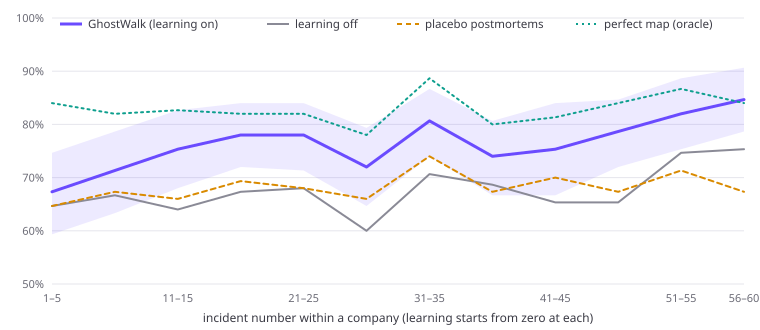
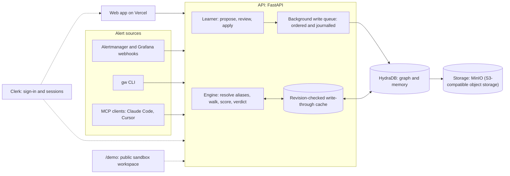
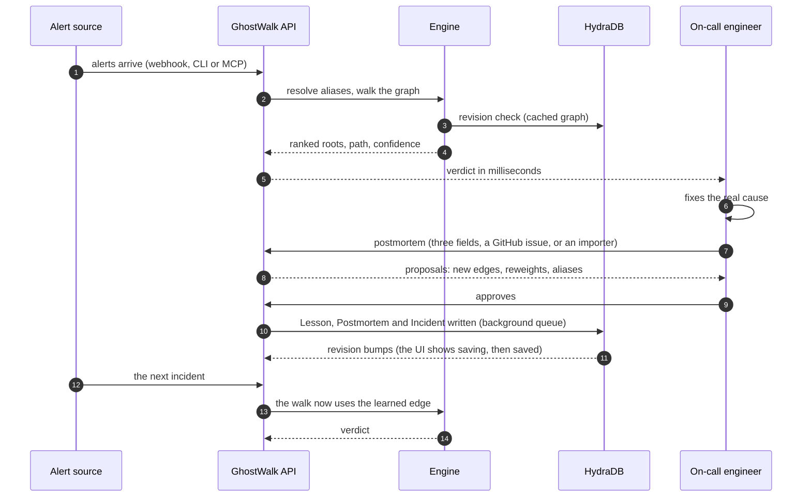
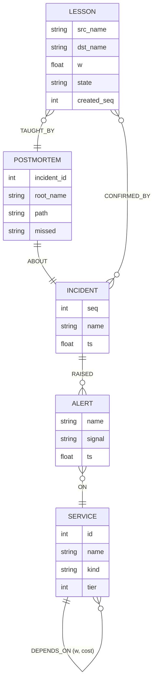
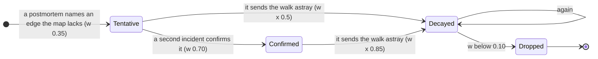

<div align="center">


# GhostWalk

**The outage is never where the pager says.**

[](https://github.com/redcode333/GhostWalk/actions/workflows/ci.yml)
[](https://github.com/redcode333/GhostWalk/actions/workflows/ci.yml)
[](LICENSE)
[](https://ghostwalk-henna.vercel.app/demo)

[**Live demo**](https://ghostwalk-henna.vercel.app/demo) · [**Proof page**](https://ghostwalk-henna.vercel.app/proof) · [**Docs**](docs)



</div>

## The 30-second version

**The problem.** When an alert storm hits, the service that pages is rarely the service that broke, and the dependency that links them is often one nobody wrote down (a generated client, a shared config, a permission). Engineers lose their first minutes, and the next incident starts from zero again.

**What GhostWalk does.** It keeps a weighted dependency graph, walks it from the alerting services to rank root causes with a confidence and a path, and learns the missing edges from your postmortems, with a guard: a new edge stays tentative until a second incident confirms it. The graph and every lesson live in [HydraDB](https://github.com/hydra-db/hydradb).

| | |
|---|---|
| **76.4%** top-1 root cause on 30 companies never used for development or tuning (1,800 incidents) | 95% CI 74.5 to 78.6%; the best baseline (tuned personalized PageRank) gets 69.9% |
| **+8.9 pts (95% CI +5.7 to +12.4)** from learning, with the placebo flat | learning off 67.6%, placebo postmortems 68.2%, GhostWalk 76.4% |
| **Graph beats vector search** at ranking root causes | 76.4% vs 38.8% for vector search over the same postmortems; a 1-hop key-value store gets 62.9% |
| **1.3 ms p50 / 1.8 ms p95 per verdict, HydraDB on MinIO, learning on, on the AWS m7i-flex.large (2 vCPU, 7.6 GB)** | laptop numbers and the load test are in [Performance](#performance-and-latency) |

**Free and open source.** GhostWalk is MIT licensed. Self-host it, or use the hosted version. One avoided hour of a wrong first guess is the return.

> Honest limits, up front: the incidents are simulated (the knobs are in the evaluation section); Postgres with recursive queries gets the same accuracy as HydraDB and is faster on raw queries at our sizes; graph memory did not beat vector retrieval at finding similar past incidents; the LLM baseline ran on a 58-incident subset, not the full set; the real-outage replays are illustrations, not an accuracy measurement.

## How it works

### Architecture



Verdicts are served from a revision-checked write-through cache: when the learner writes to HydraDB it applies the identical change to the cached graph and confirms the revision HydraDB reports, and a verdict is never served from a cache that is behind HydraDB. Path computation runs in the engine. HydraDB's in-database path mode was measured and is slower at these sizes, so it is not used. Deeper version: [docs/ARCHITECTURE.md](docs/ARCHITECTURE.md).

### One incident, end to end



### The memory is the graph

GhostWalk's learning loop lives in HydraDB: every lesson is a node linked to the postmortems that taught it and the incidents that confirmed it.



`gw why-edge config-svc fraud-check`, `GET /v1/edges/{src}/{dst}/why` and an MCP tool answer "why does the map say this?" by traversing Lesson → Postmortem → Incident. A real answer from the live deployment:

```
$ gw why-edge experiment-svc ledger-db

  experiment-svc -> ledger-db   w 0.70  learned  2 confirmations

  lesson L153  confirmed  w 0.70  created at revision 4
    taught by   INC-1004  root ledger-db  path experiment-svc -> ledger-db
    confirmed   ✓ INC-1018

  gw why-edge answers by traversal: Lesson -> Postmortem -> Incident, in HydraDB
```

### Lesson lifecycle



The design reason for the guard: a single postmortem can be wrong, so it only ever creates a tentative edge that counts for little in a verdict; the edge becomes a full edge when a second incident confirms it, and it decays when it sends the walk astray. With 10% of postmortems deliberately wrong, learning still adds +8.9 pts (95% CI +5.7 to +12.3). On this benchmark, removing the guard changes top-1 accuracy by +0.3 pts, inside the noise, so no benefit from it is measured here.

### A worked example

Five alerts fire at once (config-svc (saturation), fraud-check (error_rate), payments (latency_p99), checkout-api (error_rate), web-edge (error_rate)). The pager points at the front of the stack; the cause is two hops away.

- **Before the lesson:** `fraud-check 0.80, payments 0.11, postgres-pay 0.08`; path `web-edge → checkout-api → payments → fraud-check`.
- A postmortem says the real root was `config-svc`, reached from `fraud-check` through an edge the service catalog never listed. The learner proposes it at weight 0.35 (tentative); a second incident confirms it (0.70).
- **After:** `config-svc 0.94, fraud-check 0.05, payments 0.00`; path `web-edge → checkout-api → payments → fraud-check → config-svc`. Blast radius if `config-svc` fails: `checkout-api`, `fraud-check`, `payments`.
- A search over old postmortems (TF-IDF) for the same alerts returns `INC-0907 → postgres-pay`, `INC-0931 → fraud-check`, `INC-0984 → payments`: similar text, wrong roots.

Computed by the real engine and learner on a small scenario (computed by the real engine and learner on a 9-service scenario; the second matching incident confirms the edge).

## Proof

All numbers on this page are generated from [`results.json`](results.json) by `scripts/update_readme_numbers.py` (commit c116282). The held-out split was used for declared runs only; every tuned setting was fitted on a separate DEV split.

### Main results

| method | AC@1 [95% CI] | AC@3 [95% CI] | mean checks to root |
|---|---|---|---|
| **GhostWalk (multi-hop walk + learning)** | 76.4% [74.5, 78.6] | 90.7% [89.0, 92.1] | 2.00 |
| GhostWalk, learning off | 67.6% [63.6, 71.5] | 84.2% [80.7, 87.5] | 2.39 |
| GhostWalk, placebo postmortems | 68.2% [64.7, 71.7] | 82.7% [78.6, 86.4] |  |
| GhostWalk on the true graph (oracle) | 82.9% [80.7, 85.2] | 94.8% [93.8, 95.7] |  |
| Personalized PageRank (tuned on DEV) | 69.9% [66.7, 73.0] | 83.6% [80.6, 86.1] | 3.04 |
| Personalized PageRank (untuned default) | 49.6% [45.9, 53.4] | 66.4% [62.3, 70.5] |  |
| TF-IDF retrieval of past postmortems | 41.9% [37.4, 46.8] | 59.2% [53.9, 65.0] | 3.42 |
| Deepest alerting service | 65.8% [62.8, 68.7] | 71.4% [68.2, 74.4] | 2.49 |
| Random | 21.2% [18.6, 24.0] | 48.7% [45.2, 52.6] |  |
| GhostWalk + change evidence (`--use-changes`) | 78.2% [76.2, 80.3] | 92.1% [90.6, 93.5] |  |

Learning starts from zero at each company. Confidence intervals are paired cluster bootstraps over companies (2,000 draws). Against the best baseline, GhostWalk is +6.5 pts (95% CI +3.6 to +9.8) ahead and closes 58% of the gap to the perfect-map oracle.

### How GhostWalk compares

Same incidents, same engine and learner, only the store changes (for the store rows):

| approach | AC@1 (95% CI) | Δ vs GhostWalk | verdict p50 / p95 | tokens per verdict | learns from postmortems? |
|---|---|---|---|---|---|
| **GhostWalk on HydraDB** | 76.4% [74.5, 78.6] | reference | 2.3 ms / 3.8 ms | 0 | yes: lessons in HydraDB, linked to evidence |
| Same engine on Postgres (recursive CTE) | 76.4% [74.5, 78.6] | +0.0 pts (95% CI +0.0 to +0.0): matches accuracy; the gain comes from multi-hop graph walks; Postgres is faster on raw path queries at our sizes | 17 ms / 72 ms | 0 | yes |
| Same engine in memory (no store) | 76.4% [74.5, 78.6] | +0.0 pts (95% CI +0.0 to +0.0) | 0.21 ms / 0.74 ms | 0 | yes |
| Key-value store (Redis), 1 hop | 62.9% [59.7, 66.2] | −13.5 pts (95% CI −16.7 to −10.3) | 40 ms / 61 ms | 0 | yes, 1 hop only |
| Vector search over postmortems (pgvector) | 38.8% [34.5, 43.4] | −37.6 pts (95% CI −42.4 to −32.7) | 45 ms / 48 ms | 0 | adds text, no graph |
| Keyword retrieval (TF-IDF) of past postmortems | 41.9% [37.4, 46.8] | −34.6 pts (95% CI −39.2 to −29.7) | 0.64 ms / 1.6 ms | 0 | adds text, no graph |
| Deepest alerting service | 65.8% [62.8, 68.7] | −10.7 pts (95% CI −13.9 to −7.8) | 0.02 ms / 0.09 ms | 0 | no |
| Personalized PageRank (tuned on DEV) | 69.9% [66.7, 73.0] | −6.5 pts (95% CI −9.8 to −3.6) | 0.32 ms / 0.56 ms | 0 | no |
| Random | 21.2% [18.6, 24.0] | −55.2 pts |  | 0 | no |
| GhostWalk with learning off | 67.6% [63.6, 71.5] | −8.9 pts (95% CI −12.4 to −5.7) |  | 0 | no (the learning proof) |
| GhostWalk with placebo postmortems | 68.2% [64.7, 71.7] | −8.2 pts (95% CI −11.4 to −5.4) |  | 0 | learns noise (the learning proof) |
| LLM, plain (n=58 subset) | 56.9% [42.1, 71.7] | −15.5 pts (95% CI −27.3 to −3.4) on the subset | 1,537 ms / 3,801 ms | 2,068 | no |
| LLM + memory (five past postmortems) (n=58 subset) | 67.2% [53.4, 81.0] | −5.2 pts (95% CI −15.3 to +5.2) on the subset | 1,674 ms / 4,353 ms | 2,285 | no |

1. **Graph traversal is what matters.** Replacing it with a 1-hop key-value store costs 13.5 points of top-1 accuracy and vector search over the same postmortems costs 37.6.
2. **Postgres ties on accuracy** (difference +0.0 points, 95% CI +0.0 to +0.0): the gain comes from multi-hop graph walks, not from which product stores the graph; Postgres is faster on raw path queries at our sizes (HydraDB 3.2 ms vs Postgres 0.48 ms for 5 hops at 5000 services).
3. **The LLM costs tokens and seconds per verdict.** On the 58-incident subset (the first 58 of 100 planned incidents, 17 of the 30 companies: the run stopped at the model API's daily token quota) it used about 2,068 tokens and 1,537 ms p50 per verdict (GhostWalk: none, 2.3 ms). On the same incidents GhostWalk scored 72.4% [63.8, 81.4]: ahead of the plain LLM (56.9% [42.1, 71.7]; difference +15.5 points, 95% CI +3.4 to +27.3) and not distinguishable from the LLM given five past postmortems (67.2% [53.4, 81.0]; difference +5.2 points, 95% CI -5.2 to +15.3). These intervals are wide: this is a comparison on a small, partly covered subset, not a verdict on LLMs.
4. **GhostWalk's learning lives in HydraDB**: every lesson is a node linked to the postmortem that taught it and the incident that confirmed it, and it survives restarts (durability demo, async write queue with replay).

**The LLM, on the same incidents.** Every method on the 58-incident subset:

| method | AC@1 (95% CI) | Δ AC@1 vs GhostWalk | AC@3 (95% CI) | tokens / incident | latency p50 / p95 | invalid output | provider share |
|---|---|---|---|---|---|---|---|
| GhostWalk | 72.4% [63.8, 81.4] | reference | 82.8% [72.9, 91.7] | 0 |  |  |  |
| GhostWalk, learning off | 63.8% [52.6, 74.6] | −8.6 pts (95% CI −17.2 to −1.7) | 79.3% [70.2, 87.9] | 0 |  |  |  |
| TF-IDF retrieval | 31.0% [15.8, 47.6] | −41.4 pts (95% CI −58.2 to −25.0) | 43.1% [29.6, 57.6] | 0 |  |  |  |
| LLM, plain | 56.9% [42.1, 71.7] | −15.5 pts (95% CI −27.3 to −3.4) | 65.5% [54.8, 76.3] | 2,068 | 1,537 ms / 3,801 ms | 0% | Gemini 17%, Groq 83% |
| LLM + memory | 67.2% [53.4, 81.0] | −5.2 pts (95% CI −15.3 to +5.2) | 74.1% [62.5, 85.5] | 2,285 | 1,674 ms / 4,353 ms | 0% | Gemini 16%, Groq 84% |

LLM baseline: Gemini with Groq fallback on rate limits (model recorded per incident). GhostWalk itself uses no LLM. 58 incidents across 17 companies, chosen with a fixed seed and saved to `eval/llm_subset.json` before any call: three per company (one each from the early, middle and late third of its incidents, never the first), plus a fourth for ten seeded companies. Models used (recorded per incident in `eval/llm_cache/`): gemini-3.6-flash, openai/gpt-oss-120b. temperature 0, strict JSON, one retry on bad JSON then a miss. The run stopped when Groq's free daily token limit was reached: these are the first 58 of the 100 planned incidents in company order (17 of 30 companies; families covered: hub, layered; not reached: real); `python eval/llm_baseline.py` resumes from the cache once the limit resets.

### Learning proof

| variant | AC@1 [95% CI] |
|---|---|
| GhostWalk, learning off | 67.6% [63.6, 71.5] |
| GhostWalk, placebo postmortems | 68.2% [64.7, 71.7] |
| GhostWalk (multi-hop walk + learning) | 76.4% [74.5, 78.6] |
| GhostWalk on the true graph (oracle) | 82.9% [80.7, 85.2] |

Learning gain over learning off: +8.9 pts (95% CI +5.7 to +12.4). Placebo postmortems (a random root and random edges, same shape, no information) move accuracy by +0.7 pts: the gain is the content of the postmortems, not the act of learning.

Removing one learning step at a time:

| learning step removed | AC@1 [95% CI] | change vs full learner |
|---|---|---|
| hidden-edge discovery | 74.0% [71.6, 76.6] | −2.4 pts |
| reweighting | 76.4% [74.3, 78.6] | −0.1 pts |
| aliases | 73.6% [71.2, 76.3] | −2.8 pts |
| shortcuts | 76.2% [74.2, 78.4] | −0.2 pts |
| guard (tentative until confirmed) | 76.8% [74.9, 78.9] | +0.3 pts |
| blind-spot counters | 76.8% [74.8, 79.0] | +0.4 pts |

How deep the walk needs to go (max hops):

| max hops | AC@1 [95% CI] |
|---|---|
| 1 | 62.9% [59.7, 66.2] |
| 2 | 73.7% [71.7, 75.8] |
| 3 | 76.3% [74.4, 78.3] |
| 4 | 76.3% [74.3, 78.4] |
| 5 | 76.4% [74.5, 78.6] |

**When postmortems are wrong.** The simulator makes a share of postmortems point at the wrong root; the guard keeps learning useful:

| wrong postmortems | GhostWalk AC@1 | learning off AC@1 | gain from learning |
|---|---|---|---|
| 10% | 76.4% [74.4, 78.7] | 67.6% [63.6, 71.5] | +8.9 pts (95% CI +5.7 to +12.3) |
| 20% | 76.3% [73.8, 78.6] | 65.4% [61.5, 69.4] | +10.8 pts (95% CI +7.6 to +14.2) |
| 32% | 74.3% [71.4, 77.0] | 66.1% [63.4, 68.8] | +8.2 pts (95% CI +5.4 to +11.4) |

**New and repeat incidents.** repeat = this incident's (root, entry alerting service) pair occurred in an earlier incident at the same company (43% of incidents are repeats.)

| method | root seen before (repeat) | root never seen (novel) |
|---|---|---|
| GhostWalk (multi-hop walk + learning) | 84.5% [81.0, 88.1] | 70.4% [67.7, 73.2] |
| GhostWalk, learning off | 66.2% [60.1, 72.7] | 68.6% [65.5, 71.6] |
| TF-IDF retrieval | 69.2% [63.7, 74.8] | 21.4% [19.3, 23.7] |

### Selective accuracy: abstain when unsure

Every verdict carries a confidence. Answering only above a threshold trades coverage for accuracy:

| answer only when confidence | share of incidents answered | AC@1 on those |
|---|---|---|
| ≥ 0.0 | 100% | 76.4% |
| ≥ 0.2 | 98% | 77.5% |
| ≥ 0.4 | 90% | 82.2% |
| ≥ 0.6 | 76% | 87.5% |
| ≥ 0.8 | 58% | 91.8% |

### What didn't win

**Graph memory did not beat ordinary retrieval at finding similar past incidents.** Retrieving the five most relevant past incidents of the same company, using only past incidents (hit@5: a retrieved incident has the same root cause; repeat incidents only; 95% CIs in brackets):

|  | graph (HydraDB) | vector (pgvector) | keyword (TF-IDF) |
|---|---|---|---|
| hit@5, repeat incidents (n=1,175) | 84.3% [82.1, 86.7] | 87.3% [85.0, 89.3] | 89.5% [87.5, 91.5] |
| MRR, repeat incidents | 0.709 [0.674, 0.744] | 0.721 [0.697, 0.745] | 0.746 [0.718, 0.770] |
| related@5, novel incidents (n=595) | 20.2% [17.3, 23.3] | 24.5% [20.4, 28.5] | 25.4% [21.4, 29.1] |
| retrieval latency p50 / p95 | 3.9 ms / 7.5 ms | 1.3 ms / 1.8 ms | 0.56 ms / 1.0 ms |

On repeat incidents, graph memory is behind vector search (−3.0 pts (95% CI −5.8 to −0.1)) and behind TF-IDF (−5.2 pts (95% CI −8.0 to −2.4)). Graph retrieval first took 164 ms p50 as a HydraDB query per step; now it expands the neighbourhood on the revision-checked cached graph and keeps a per-revision index (3.9 ms p50), returning identical lists for all 1,770 incidents. Looking up similar past incidents is easy in this setting: a repeat incident usually alerts on the same services, so a bag-of-words match on the alert text finds it and the graph adds nothing. **The graph matters for root-cause ranking, which is a different job**: 76.4% for the walk against 41.9% for TF-IDF retrieval and 38.8% for vector search (see [the store swap](#how-ghostwalk-compares)).

**Change evidence helps only in a corner.** With the change evidence on (`--use-changes`, weights fitted on DEV): 78.2% [76.2, 80.3] against 76.4% [74.5, 78.6] without, a gain of +1.7 pts (95% CI +1.1 to +2.4). Sensitivity (simulated knobs: how often the root's own change precedes the incident, and how many distractor changes there are):

| root's own change rate ↓ / distractor noise → | 0.5 | 2.0 | 5.0 |
|---|---|---|---|
| 0.2 | +0.8 pts | +0.4 pts (CI includes 0) | +0.2 pts (CI includes 0) |
| 0.5 | +1.9 pts | +1.7 pts | +1.1 pts |
| 0.8 | +3.4 pts | +3.3 pts | +2.7 pts |

helps only when the root's own change is common: reliable gain (95% CI above 0) for p_root in [0.5, 0.8]; at p_root=0.2 the gain is +0.4 pts with a CI that includes 0. Distractor noise up to r_noise=5 does not remove it at p_root=0.5.

### Real-outage replays

| scenario | GhostWalk, official map (hidden dependency missing) | after one learned edge (tentative) | after a second incident confirms it | deepest alert | LLM |
|---|---|---|---|---|---|
| [AWS us-east-1, 20 Oct 2025](https://aws.amazon.com/message/101925/): real root `dynamodb-dns-automation` | dynamodb (1.00); real root not ranked | dynamodb (1.00); real root rank 3 | dynamodb (0.99); real root rank 2 | dynamodb; real root not ranked | dynamodb; real root not ranked (gemini) |
| [Cloudflare, 18 Nov 2025](https://blog.cloudflare.com/18-november-2025-outage/): real root `clickhouse-db` | core-proxy (0.96); real root not ranked | core-proxy (0.96); real root rank 6 | core-proxy (0.95); real root rank 3 | status-page; real root not ranked | core-proxy; real root not ranked (groq) |

Replay built from the public postmortem; illustrative, not an accuracy measurement. One run per scenario, on a map and an alert order we built from the public description: this shows the mechanism, not an accuracy. With the dependency missing GhostWalk is confidently wrong, like the responders were; after one learned edge the real root enters the ranking but is not first. We make no claim that GhostWalk would have prevented either outage.

The scenarios, their sources and the assumptions are in [`docs/replays/`](docs/replays); run them live from the Replay buttons on the Incidents page of the [demo](https://ghostwalk-henna.vercel.app/demo).

### Judging checklist

| what a reviewer would ask | evidence |
|---|---|
| Works end to end on a live deployment | [live demo](https://ghostwalk-henna.vercel.app/demo), [smoke test](deploy/smoke.py), [`docs/deploy.md`](docs/deploy.md) |
| Measured on unseen data, not claimed | 30 held-out companies, test split used for declared runs only: [Proof](#proof), [`results.json`](results.json) |
| Learning is real, not an artefact | [learning off and placebo controls, ablations, poisoning](#learning-proof) |
| Honest about what did not win | [What didn't win](#what-didnt-win), [Postgres ties on accuracy](#how-ghostwalk-compares) |
| Uses HydraDB for more than a cache | graph, weights and the learner's memory in HydraDB: [memory schema](#how-it-works), [`ghostwalk/graph/hydra.py`](ghostwalk/graph/hydra.py), [parity tests](tests/test_parity.py) |
| Found and reported a HydraDB bug | [`docs/hydradb-issue.md`](docs/hydradb-issue.md) (root cause from the source, curl reproduction, fix and regression test) |
| Survives restarts | [durability demo](docs/measurements/durability_demo_vm.txt), [async write queue with replay](tests/test_async_learning.py) |
| Reproducible | `make eval-quick`, `make bench`, `make loadtest`; seeds, commit and engine settings are recorded in `results.json` |
| Tested | unit, parity (HydraDB against in-memory), memory, tenancy and isolation, async-write replay, restart and replay tests: [`tests/`](tests), run in CI |

## Performance and latency

Every number below is measured, labelled with the machine, and reproducible. Full tables: [docs/PERFORMANCE.md](docs/PERFORMANCE.md).

| machine | what | how it was used |
|---|---|---|
| laptop | Windows-11-10.0.26300, 16 logical CPUs, 7.6 GB RAM, Python 3.12.4 | client on the host; HydraDB and Postgres in Docker Desktop containers through published ports (transport fixed, see below) |
| VM | AWS m7i-flex.large, Intel(R) Xeon(R) Platinum 8488C, 2 vCPU, 7.6 GB RAM, Linux 7.0.0-1016-aws, Python 3.12.16 | client in the API container, HydraDB on the same Docker network (no proxy hop); HydraDB's data in MinIO or on local disk, as labelled |

**Per query on HydraDB** (p50 / p95, 200 timed requests after 20 warm-up):

| query (one at a time, after warm-up) | HydraDB, laptop | Postgres, laptop | HydraDB, VM, MinIO | HydraDB, VM, local disk |
|---|---|---|---|---|
| 1-hop neighbours | 2.7 ms / 3.8 ms | 0.27 ms / 0.48 ms | 2.8 ms / 4.4 ms | 2.9 ms / 4.3 ms |
| best path, 3 hops | 0.53 ms / 0.84 ms | 0.37 ms / 0.53 ms | 0.39 ms / 0.53 ms | not measured |
| best path, 5 hops | 0.57 ms / 1.0 ms | 0.45 ms / 0.68 ms | 0.41 ms / 0.60 ms | not measured |
| edge-weight write | 23 ms / 24 ms | 0.77 ms / 1.1 ms | 22 ms / 24 ms | not measured |

**Per verdict** (p50 / p95):

| verdict | laptop (30 TEST companies / DEV companies) | VM, HydraDB on MinIO |
|---|---|---|
| in memory (no store) | 0.21 ms / 0.76 ms | 0.06 ms / 0.08 ms |
| HydraDB, cache hit (nothing written since the last verdict) | 1.8 ms / 2.9 ms | 0.86 ms / 1.3 ms |
| HydraDB, during learning (write-through cache, every incident) | 2.3 ms / 3.8 ms | 1.3 ms / 1.8 ms |
| HydraDB, cold read of the whole graph | 40 ms / 64 ms | 380 ms / 464 ms |
| learning write (after the verdict, off the verdict path) | 403 ms / 1,071 ms | 559 ms / 1,520 ms |

The cold read (the whole graph read back from HydraDB, which the cache avoids) is slower on the VM than on the laptop; HydraDB reads from MinIO there, and we did not isolate how much of the difference is that. Verdicts stay in the low milliseconds because they read the cached graph; the learning write (a few dozen sequential HydraDB commits) happens after the verdict and never delays one.

**Scale** (synthetic layered graphs, same generator, one machine; the in-database verdict is the slow path and is not used):

| services | engine verdict (in memory) | HydraDB 3 hops | Postgres 3 hops | HydraDB 5 hops | Postgres 5 hops | whole verdict p50: HydraDB read-back / in-DB / Postgres |
|---|---|---|---|---|---|---|
| 100 | 0.63 ms / 0.84 ms | 1.7 ms / 2.9 ms | 0.42 ms / 0.83 ms | 2.1 ms / 3.5 ms | 0.42 ms / 0.75 ms | 40 ms / 234 ms / 3.5 ms |
| 1000 | 15 ms / 22 ms | 5.4 ms / 11 ms | 0.98 ms / 4.1 ms | 3.0 ms / 5.8 ms | 0.76 ms / 1.7 ms | 475 ms / 1,905 ms / 12 ms |
| 5000 | 85 ms / 116 ms | 4.1 ms / 6.5 ms | 0.53 ms / 0.83 ms | 3.2 ms / 7.6 ms | 0.48 ms / 0.64 ms | 2,472 ms / 97,623 ms / 210 ms |

**Load test on the VM** (`make loadtest`):

| concurrent clients | requests / s | latency p50 / p95 / p99 | errors | API container CPU (% of one core) | API container memory |
|---|---|---|---|---|---|
| 1 | 91 | 11 ms / 18 ms / 24 ms | 0 | 98% | 151 MB |
| 10 | 45 | 219 ms / 272 ms / 306 ms | 0 | 104% | 158 MB |
| 50 | 33 | 1,576 ms / 1,636 ms / 1,663 ms | 0 | 108% | 164 MB |
| 100 | 26 | 3,451 ms / 5,869 ms / 5,992 ms | 0 | 120% | 176 MB |

Each level ran 10 s against `POST /v1/alerts/demo` inside the API container on the VM (2 vCPUs), rate limit off; every request is a full verdict that is also recorded and saved.

Throughput falls as clients are added, and that is the honest limit of this version: the walk is 0.06 ms of each request (in memory, same VM), but every request takes the workspace lock, records the incident and rewrites the workspace's state file, which grows with the incidents recorded. Batching or journalling that save is the obvious next fix; it is not done.

**The transport diagnosis, in three lines.** HydraDB answers a read in about 0.94 ms (its own metrics), yet every request from the Windows host took about 47 ms. The cause was the Docker Desktop published-port hop reacting to HTTP clients that write headers and body separately; a client that sends them in one write takes 0.64 ms through the same port, so the adapter now does that (`ghostwalk/graph/fasthttp.py`). Those 47 ms were never HydraDB's.

**The HydraDB restart bug.** HydraDB 0.4.0 rejected every HTTP write after a restart (`409 mutation_conflict`), because HTTP requests are numbered `http-query-1, 2, ...` from the start of every process and writes are deduplicated durably by that number. Fixed on our side by sending a unique `query_id` with every request (regression test: `tests/test_hydra_restart.py`); root cause from the source and a curl reproduction: [docs/hydradb-issue.md](docs/hydradb-issue.md). Not filed upstream yet.

**Reproduce:** `make bench` (engine at scale), `make bench-hydra` (HydraDB per query and per verdict, needs `docker compose --profile eval up -d hydradb postgres`), `make loadtest URL=...`, and on a VM `deploy/measure_vm.py` and `deploy/loadtest_vm.sh`.

## Quickstart

```bash
git clone https://github.com/redcode333/GhostWalk && cd GhostWalk
docker compose up -d --build            # the app on http://localhost:8000
GW_STORE=hydradb docker compose up -d hydradb app    # optional: the graph and the memory in HydraDB
docker compose exec app gw doctor --url http://127.0.0.1:8000
```

Open http://localhost:8000 (the demo workspace needs no sign-in). Then:

```bash
pip install -e .
gw demo                          # a demo workspace and the next outage as alerts.json
gw why --alerts alerts.json      # the verdict
gw learn INC-1030 --root config-svc --path "config-svc -> fraud-check -> checkout-api"
```

**MCP, for Claude Code and Cursor.** `gw mcp` is a stdio server. Local (reads the workspace `gw` saved):

```bash
claude mcp add ghostwalk -- gw mcp
```

```json
{ "mcpServers": { "ghostwalk": { "command": "gw", "args": ["mcp"] } } }
```

Hosted (forwards to a GhostWalk server): set `GW_URL` and `GW_TOKEN` in the `env` of the same entry.

**Configuration** (`.env.example`):

| variable | what it is | secret? | notes |
|---|---|---|---|
| AUTH_MODE | none or clerk | no | `clerk`: `/app` needs a Clerk session and every user gets their own workspace; `/demo` stays public. |
| CLERK_PUBLISHABLE_KEY, VITE_CLERK_PUBLISHABLE_KEY | Clerk publishable key | no (public) | The browser's Clerk SDK; the second name is the build-time variable on Vercel. |
| CLERK_SECRET_KEY | Clerk secret key | **yes** | Only for tooling that talks to Clerk's backend API (the live smoke test). The API does not need it to verify sessions. |
| CLERK_JWKS_URL | Clerk's JWKS URL | no | Session tokens are verified against these keys (cached); issuer and authorised party are checked. |
| GW_STORE | memory or hydradb | no | `hydradb`: the graph and the learner's memory live in HydraDB. |
| HYDRA_URL, HYDRA_TOKEN | HydraDB address and bearer token | token: **yes** | Defaults to the compose service; the token must be at least thirty-two bytes. |
| GW_DEMO_INCIDENTS | past incidents in the demo workspace | no | The seeded history the demo starts with. |
| GW_PUBLIC_DEMO | 0 or 1 | no | `1`: settings, onboarding and webhooks are read-only in the demo sandbox, and it is rebuilt every night. |
| GW_ADMIN_TOKEN | admin token | **yes** | Lets `POST /api/demo/reset` rebuild the demo on demand. |
| GW_RATE_LIMIT | requests/seconds, e.g. 60/60 | no | Per client, on `/v1/*` and on POSTs. `0` turns it off (load tests). |
| GW_CORS_ORIGINS | comma-separated origins | no | The frontend origin(s) allowed to call the API; also the authorised parties for Clerk sessions. |
| GW_HOME | folder | no | Where the `gw` CLI keeps its workspace. |
| GW_URL, GW_TOKEN | API address and a workspace token | token: **yes** | Point `gw` and `gw mcp` at a hosted GhostWalk. Tokens look like `gw_live_<workspace>_<secret>`; only a hash is stored and the token is shown once. |
| GEMINI_API_KEY, GROQ_API_KEY | LLM keys | **yes** | Only for `eval/llm_baseline.py` and `eval/replays.py`. GhostWalk itself calls no LLM. |
| GITHUB_APP_ID, GITHUB_APP_PRIVATE_KEY, GITHUB_WEBHOOK_SECRET, GITHUB_PR_TOKEN | GitHub App settings | **yes** | Optional: map import from GitHub, postmortem issues, the `gw diff` PR comment. |

## CLI and MCP reference

Every block below is the real output of the command, captured by `scripts/capture_cli_examples.py` (in a throwaway workspace; `doctor` and `why-edge` against the live deployment).

**The commands**

```
$ gw --help


 Usage: -c [OPTIONS] COMMAND [ARGS]...

 GhostWalk: why is it broken, and what should the map have said?

┌─ Options ───────────────────────────────────────────────────────────────────────────────────────┐
│ --help  -h      <bool>  Show this message and exit.                                             │
└─────────────────────────────────────────────────────────────────────────────────────────────────┘
┌─ Commands ──────────────────────────────────────────────────────────────────────────────────────┐
│ demo      Create the simulated acme-demo workspace and write the next outage to alerts.json.    │
│ why       Rank the likely root causes of an alert storm and show the path.                      │
│ doctor    Check the stack: the API, the store it uses, HydraDB, the learning queue and the      │
│           stored results.                                                                       │
│ why-edge  Why does the map say SRC depends on DST: the lesson, the postmortems that taught it,  │
│           the incidents that confirmed it (HydraDB store).                                      │
│ learn     Turn a postmortem into graph changes, review them, apply.                             │
│ eval      The held-out numbers: AC@1 with 95% bootstrap intervals, the gain over the best       │
│           baseline, the gap closed.                                                             │
│ export    The graph (official + learned) and incident roots as JSON: the input `gw diff` needs  │
│           in CI. `gw export > graph.json`.                                                      │
│ diff      Pre-deploy blast radius: dependencies this change adds or removes, and what hangs off │
│           them. Read-only, works offline.                                                       │
│ mcp       Run the MCP server on stdio (tools: why, path, blast_radius, why_edge, lesson_impact, │
│           propose_edge). Read-only; GW_URL + GW_TOKEN for hosted mode.                          │
│ map       The dependency map.                                                                   │
│ change    What changed: deploys and config changes the verdict can use.                         │
└─────────────────────────────────────────────────────────────────────────────────────────────────┘
```

**A demo workspace and the next outage**

```
$ gw demo

  acme-demo · 80 services · 30 past incidents
  wrote alerts.json (46 alerts). Now: gw why --alerts alerts.json
```

**Who broke it**

```
$ gw why --alerts alerts.json

  46 alerts · 46 services · walked 161 edges in 2 ms

  rank  service            confidence
  1     redis-sessions    ████████████████████  1.00
  2     session-svc       ░░░░░░░░░░░░░░░░░░░░  0.00
  3     auth-svc          ░░░░░░░░░░░░░░░░░░░░  0.00

  path  edge-gateway → inventory-api → redis-sessions

  why   explains 32 of 46 alerts · fired in path order
  INC-1030 saved. Teach it: gw learn INC-1030 --root redis-sessions
```

**Teach it what the postmortem found**

```
$ gw learn INC-1030 --root session-svc

  reading postmortem · 3 fields

  + redis-sessions ⇢ session-svc      new · tentative 0.35
  − edge-gateway → inventory-api      reweight · 0.79 → 0.67
  − inventory-api → redis-sessions    reweight · 0.85 → 0.72

  ✓ graph updated · revision 31
```

**Import a dependency map from repos**

```
$ gw map import /tmp/gw\acme

  scanning 3 repos …

  docker-compose.yml          9 edges
  k8s/*.yaml                  2 edges
  Helm values                 2 edges
  env vars  *_URL             6 edges

  ✓ 15 services · 17 dependencies

    ● edge 1   ● service 9   ● data 4   ● infra 1
  2 low-confidence edges left out (use --all to include)
```

**Record a deploy the verdict can use**

```
$ gw change add redis-sessions --ref #482

  ✓ redis-sessions · deploy #482
```

**The held-out numbers**

```
$ gw eval --split test

  30 held-out companies · 95% bootstrap CI

  method           AC@1   95% CI
  perfect map      0.829  0.807–0.852  █████████████████
  ghostwalk        0.764  0.745–0.786  ███████████████
  pagerank (tuned) 0.699  0.667–0.730  ██████████████
  placebo          0.682  0.647–0.717  ██████████████
  learning off     0.676  0.636–0.715  ██████████████
  deepest alert    0.658  0.628–0.687  █████████████
  tf-idf retrieval 0.419  0.374–0.468  ████████
  random           0.212  0.186–0.240  ████

  ✓ gain vs best baseline +6.5 pts (pagerank)   gap closed 58%
  ✓ results.json read · c116282 · 2026-11-15
```

**Export the graph (the input of `gw diff` in CI)**

```
$ gw export --out D:\Temp\tmp9kkgb7ot\graph.json


```

**Pre-deploy blast radius of a change**

```
$ gw diff --base HEAD~1 --head HEAD

  2 added · 1 removed dependencies

  + fraud-check → config-svc
      blast radius 25 services  admin-api, billing-svc, catalog-svc, consent-svc, fraud-svc, …
      config-svc caused INC-1002, INC-1009
  + search → redis-main
      redis-main is not in the graph yet
  − cart → redis-main  removed (docker-compose.yml)
```

**The MCP server (stdio; started by Claude Code or Cursor)**

```
$ gw mcp --help


 Usage: -c mcp [OPTIONS]

 Run the MCP server on stdio (tools: why, path, blast_radius, why_edge, lesson_impact,
 propose_edge). Read-only; GW_URL + GW_TOKEN for hosted mode.

┌─ Options ───────────────────────────────────────────────────────────────────────────────────────┐
│ --help  -h      <bool>  Show this message and exit.                                             │
└─────────────────────────────────────────────────────────────────────────────────────────────────┘
```

**Check a running stack**

```
$ gw doctor

  ✓ api                   https://api.13-51-194-36.sslip.io {'ok': True, 'services': 80, 'store':
'hydradb', 'revision': 31, 'saving': 0, 'public_demo': True, 'writer_error': None}
  ✓ workspace             80 services, 8 learned edges, revision 31
  ✓ store                 HydraDB graph (memory in the graph) (hydradb)
  ✓ learning queue        saving 0
  ✓ hydradb               ready (http://127.0.0.1:9090/readyz)
  ✓ results.json          30 held-out companies

  ✓ all checks passed
```

**Why does the map say this?**

```
$ gw why-edge experiment-svc ledger-db

  experiment-svc -> ledger-db   w 0.79  learned  2 confirmations

  lesson L153  confirmed  w 0.79  created at revision 4
    taught by   INC-1004  root ledger-db  path experiment-svc -> ledger-db
    confirmed   ✓ INC-1018

  gw why-edge answers by traversal: Lesson -> Postmortem -> Incident, in HydraDB
```

### The six MCP tools

| tool | arguments | what it does |
|---|---|---|
| `why` | `alerts` (service names, or `{name, signal, t}`; Alertmanager and Grafana payloads work) | ranks root causes with a confidence, the path and an explanation |
| `path` | `root`, `service` | explains how `service` depends on `root`, hop by hop, and which hops were learned |
| `blast_radius` | `service`, `hops` | what is affected if `service` fails |
| `why_edge` | `src`, `dst` | the lesson behind a learned edge, the postmortems that taught it and the incidents that confirmed it (HydraDB store) |
| `lesson_impact` | `lesson_id` | the services and past incidents whose paths use a learned edge |
| `propose_edge` | `src`, `dst`, `incident_id`, `reason` | suggests a lesson as a pending proposal; a person approves it, nothing is written |

GhostWalk never calls an LLM. The assistant asks and the graph answers.

## How it differs from OpenTelemetry and observability tools

| | OpenTelemetry | Observability tools | GhostWalk |
|---|---|---|---|
| what it is | a standard for collecting traces, metrics and logs | dashboards, search and alerting over telemetry | root-cause ranking over a dependency graph that learns |
| decides which failure explains the alerts | no | no, it shows what is happening | yes, with a confidence and a path |
| knows dependencies that never show up in telemetry (generated files, shared config, permissions) | no | no | yes, learned from postmortems with a guard |
| learns from your incidents | no | no | yes |

OpenTelemetry collects; it does not decide root cause or learn. Observability tools show what is happening; GhostWalk decides which failure explains the alerts and remembers dependencies that telemetry cannot see. They are complementary: OpenTelemetry traces are a planned evidence source for GhostWalk's learner.

## Evaluation method

Short version here; full method in [docs/EVALUATION.md](docs/EVALUATION.md).

- **Simulator.** `gwsim` builds companies from three families (hub, layered, and real-topology-shaped) with hidden edges missing from the official map, aliases, silent services, and a share of wrong postmortems.
- **Splits.** Weights and baselines are tuned on DEV only; the test split is used for declared final runs. Learning starts from zero at every company; each incident is predicted before its postmortem is learned from.
- **Statistics.** Paired cluster bootstrap over companies (2,000 draws). Controls: learning off, placebo postmortems (random root and edges), the perfect-map oracle, and a poisoning stress at several wrong-postmortem rates.
- **The test rerun history, in full.** Top-1 hits of 1,800 moved 1379 → 1380 → 1376: the first change reordered exact ties after a speed optimisation, the second added a deterministic tie-break; every table in `results.json` comes from the final engine (1376 of 1,800).
- **Citations.** The topologies of two of the three real-system families follow RCAEval's published microservice systems; no RCAEval data is used. The PageRank baseline follows MicroRCA-style personalised PageRank, tuned on DEV (the untuned default is shown too).
- **Limitations.** The incidents are simulated; there are no replayed real outages; the LLM baseline covers 58 incidents (a stratified subset, not all of them) and the free-tier models changed during the run (the model is recorded per incident); the replays are two scenarios we built from public postmortems; Postgres is faster on raw queries at our sizes; the change-evidence gain is small and conditional.

## Future work

- **Rust.** A single-binary `gw` CLI and MCP server in Rust; the walk engine as a Rust extension (PyO3) once the scale benchmark demands it (the engine's p95 at the largest size is 116 ms, inside the budget); long term, the walk as a HydraDB-native procedure with no network hop. The Python engine stays the reference implementation, with CI parity tests.
- **OpenTelemetry traces** as a fourth evidence source, with the same tentative-then-confirmed guard.
- **Multi-path reach** (top-k paths), **cross-company learned priors** for a cold start, and a **temporal graph** ("what did we believe at incident time").
- **External validation** on RCAEval recorded faults, as a CI job.
- **Integrations:** a Slack and Teams verdict bot, native PagerDuty, Grafana and Datadog apps, the GitHub App and the `gw diff` PR check to general availability.
- **Production:** object storage on AWS S3, SSO and SAML, a SOC 2 path.
- **Upstream:** the HydraDB restart bug ([docs/hydradb-issue.md](docs/hydradb-issue.md)); the filed issue will be linked here.

## Project structure

```
ghostwalk/            the product
  engine/             the walk: resolve aliases, score, verdict (frozen)
  learn/              the learner: propose and apply graph changes from postmortems (frozen)
  graph/              the graph state, the HydraDB adapter, the fast HTTP client
  api/                FastAPI app, workspace, demo sandbox, alert normalisers
  discover/           map import from compose, Kubernetes, Helm, *_URL settings
  integrations/       GitHub App, postmortem issues
  cli.py, mcp_*.py    the gw CLI and the MCP server
gwsim/                the incident simulator (families, knobs, hidden edges)
baselines/            PageRank, deepest-alert, retrieval, random
eval/                 the evaluation harness, store swap, latency and load tests
web/                  the React app (landing, auth, dashboard, Proof page)
deploy/               production compose, Caddy, MinIO, setup, smoke test, VM scripts
docs/                 architecture, performance, evaluation, graph-vs-sql, measurements
scripts/              generators for this README, the docs and the proof card
tests/                unit, parity (HydraDB vs in-memory), memory, async-write and restart tests
results.json         every measured number
```

## Contributing

Run `pytest` (the HydraDB tests need `docker compose up -d hydradb` and skip otherwise) and `cd web && npm test`. The engine and learner are frozen: changes to scoring need a DEV result and a new declared test run, recorded in `results.json`. Numbers in the README and docs are generated: edit `docs/templates/*.tpl.md` or `scripts/readme_blocks.py`, then run `python scripts/update_readme_numbers.py`; CI fails if the README is stale or a typed number appears in the prose. Commits carry no AI co-author or attribution lines.

## License

MIT, see [LICENSE](LICENSE).

## Acknowledgements

[HydraDB](https://github.com/hydra-db/hydradb) for the graph store and for an unusually readable codebase; [RCAEval](https://github.com/phamquiluan/RCAEval) for the microservice topologies and the benchmark that sets the bar; MicroRCA for the PageRank formulation we compare against.
