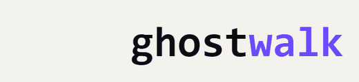
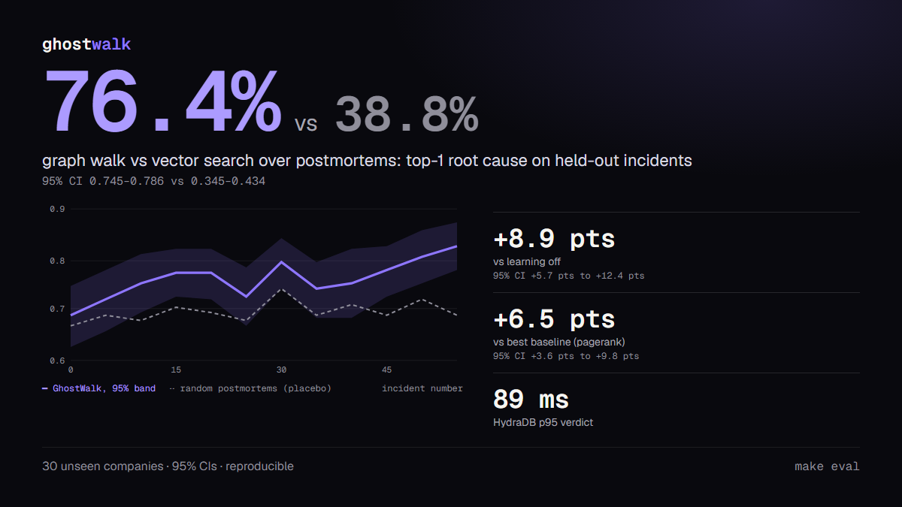
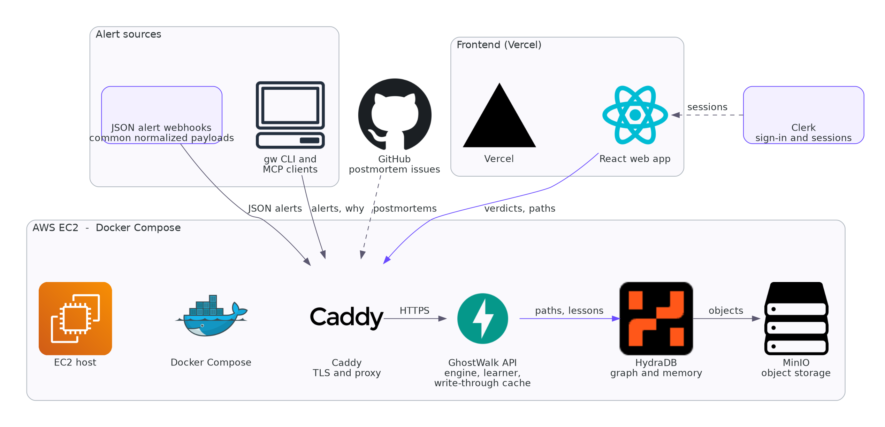
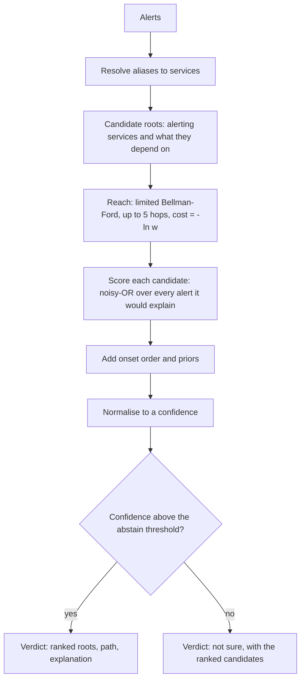
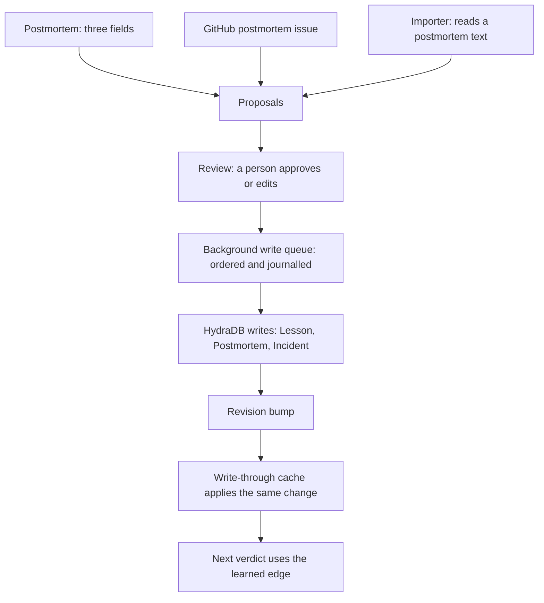
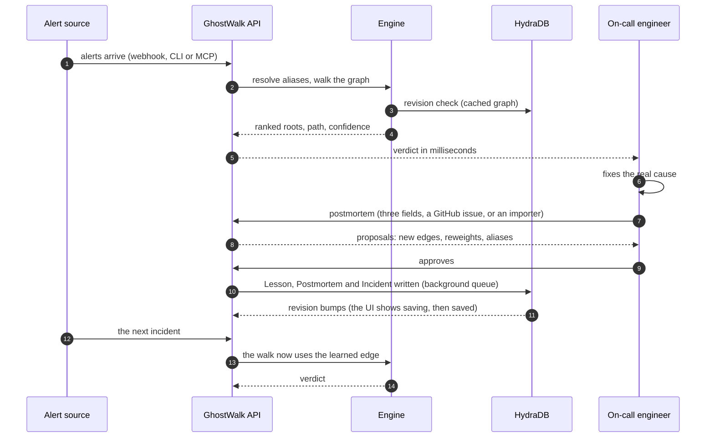
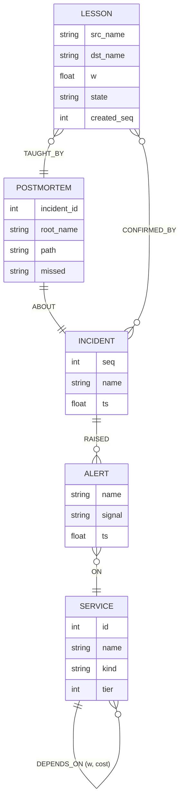
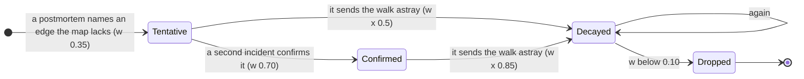

<div align="center">



# GhostWalk

**Root cause analysis that learns the dependencies nobody drew.**

*The outage is never where the pager says.*

**+6.5 pts vs best baseline (tuned PageRank) · +13.5 pts vs a key-value store · +37.6 pts vs a vector store · +8.9 pts from learning · 1.3 ms verdict p50**

[](https://github.com/redcode333/GhostWalk/actions/workflows/ci.yml)
[](https://github.com/redcode333/GhostWalk/actions/workflows/ci.yml)
[](LICENSE)
[](https://ghostwalk-henna.vercel.app/demo)


[**Live demo**](https://ghostwalk-henna.vercel.app/demo) · [**Proof**](https://ghostwalk-henna.vercel.app/proof) · [**Docs**](docs)

</div>

<p align="center"></p>

## Results

All numbers come from [`results.json`](results.json), generated by `scripts/update_readme_numbers.py` (commit c116282). Details are in [docs/EVALUATION.md](docs/EVALUATION.md).

- **76.4%** top-1 root cause on 30 companies never used for development or tuning (1,800 incidents), 95% CI 74.5 to 78.6%.
- Learning adds **+8.9 pts (95% CI +5.7 to +12.4)** over learning off. Placebo postmortems add +0.7 pts over the whole run.
- The graph walk is what matters. Remove the graph and accuracy collapses: **76.4%** for the walk against 38.8% for vector search and 62.9% for a 1-hop key-value store.
- **+6.5 pts (95% CI +3.6 to +9.8)** over the best baseline (tuned personalized PageRank, 69.9%).
- **2.8 ms** p50 for a HydraDB 1-hop query and **1.3 ms** p50 per verdict, on the AWS m7i-flex.large (2 vCPU, 7.6 GB), HydraDB on MinIO.
- An LLM given the same alerts and map gets 56.9% (plain) and 67.2% (with past postmortems) against 72.4% for GhostWalk, on a 58-incident subset; it costs about 2,068 tokens and 1,537 ms per verdict.
- Lessons persist in HydraDB across restarts, each linked to the postmortem that taught it and the incidents that confirmed it.

## The problem

When an alert storm hits, the service that pages is rarely the service that broke. The dependency that links them is often one nobody wrote down: a generated file, a shared config, a permission. Engineers lose their first minutes, and the next incident starts from zero again.

Example: on 18 November 2025 a database permissions change made a Bot Management feature file grow past a limit and crashed Cloudflare's core proxy, while the alerts pointed at login, Workers KV and Access ([postmortem](https://blog.cloudflare.com/18-november-2025-outage/)).

## How it works

1. Alerts arrive from a webhook, the CLI or an MCP client, and are resolved to services.
2. The engine walks the weighted dependency graph from every alerting service, up to five hops.
3. It ranks root causes with a confidence, the path from each root to the alerts, and the reason. Below a threshold it says it is not sure.
4. After the incident, a postmortem proposes missing edges. A new edge starts tentative and counts for little.
5. A second incident confirms it. Edges that keep misleading decay and drop. Every lesson is stored in HydraDB, linked to its evidence.



## Why HydraDB

- **Multi-hop weighted paths.** The verdict is a walk over a weighted graph. Take the graph away and accuracy collapses (see Results).
- **Graph memory.** Every lesson is a node linked to the postmortem that taught it and the incidents that confirmed it, so `gw why-edge` can answer "why does the map say this?". It survives restarts.
- **Object storage.** HydraDB keeps its data on S3-compatible storage. The live deployment runs MinIO on the EC2 host; production S3 is on the roadmap.

A relational database with recursive SQL matches accuracy; HydraDB gives native graph paths and graph memory in one store. The comparison is in [docs/EVALUATION.md](docs/EVALUATION.md).

## Design

The engine turns alerts into a verdict. Deeper reasoning: [docs/ARCHITECTURE.md](docs/ARCHITECTURE.md).



The learner turns a postmortem into reviewed, ordered writes. Verdicts keep reading the last committed graph while it works.



One incident, end to end:



The memory is a graph: lessons point at the postmortems and incidents that justify them.



A lesson is tentative until a second incident confirms it, and it decays when it misleads:



## Results in detail

| approach | AC@1 (95% CI) | takeaway |
|---|---|---|
| **GhostWalk** | 76.4% [74.5, 78.6] | The reference. |
| Learning off | 67.6% [63.6, 71.5] | Same engine, no postmortem learning: the gap is what learning adds. |
| Placebo postmortems | 68.2% [64.7, 71.7] | Random root and edges: learning from noise adds nothing. |
| Best baseline (tuned PageRank) | 69.9% [66.7, 73.0] | A graph method with no learning. |
| Key-value store, 1 hop | 62.9% [59.7, 66.2] | Direct neighbours only: it misses multi-hop dependencies. |
| Vector search (pgvector) | 38.8% [34.5, 43.4] | Similar text is not a causal path. |
| LLM, plain (n=58 subset) | 56.9% [42.1, 71.7] | Costs tokens and seconds per verdict, with no graph path behind the answer. |
| Perfect map (oracle) | 82.9% [80.7, 85.2] | The ceiling if every dependency were known. |

<p align="center"><picture><source media="(prefers-color-scheme: dark)" srcset="docs/learning-curve-dark.png"></picture></p>

Learning starts from zero at each company. Intervals are paired cluster bootstraps over companies. The incidents are simulated; the claim is the comparison between methods on the same incidents. Every table, the ablations and the limits: [docs/EVALUATION.md](docs/EVALUATION.md).

## Performance

Measured on the AWS m7i-flex.large (2 vCPU, 7.6 GB), HydraDB on MinIO, and on a laptop. Verdicts read a cached graph, so they stay in the low milliseconds; the learning write happens after the verdict.

| verdict | laptop (30 TEST companies / DEV companies) | VM, HydraDB on MinIO |
|---|---|---|
| in memory (no store) | 0.21 ms / 0.76 ms | 0.06 ms / 0.08 ms |
| HydraDB, cache hit (nothing written since the last verdict) | 1.8 ms / 2.9 ms | 0.86 ms / 1.3 ms |
| HydraDB, during learning (write-through cache, every incident) | 2.3 ms / 3.8 ms | 1.3 ms / 1.8 ms |
| HydraDB, cold read of the whole graph | 40 ms / 64 ms | 380 ms / 464 ms |
| learning write (after the verdict, off the verdict path) | 403 ms / 1,071 ms | 559 ms / 1,520 ms |

Load test on the VM:

| concurrent clients | requests / s | latency p50 / p95 / p99 | errors | API container CPU (% of one core) | API container memory |
|---|---|---|---|---|---|
| 1 | 91 | 11 ms / 18 ms / 24 ms | 0 | 98% | 151 MB |
| 10 | 45 | 219 ms / 272 ms / 306 ms | 0 | 104% | 158 MB |
| 50 | 33 | 1,576 ms / 1,636 ms / 1,663 ms | 0 | 108% | 164 MB |
| 100 | 26 | 3,451 ms / 5,869 ms / 5,992 ms | 0 | 120% | 176 MB |

Each level ran 10 s against `POST /v1/alerts/demo` inside the API container on the VM (2 vCPUs), rate limit off; every request is a full verdict that is also recorded and saved.

Full tables, scale runs, the transport diagnosis and the HydraDB restart bug: [docs/PERFORMANCE.md](docs/PERFORMANCE.md).

## Real-outage replay

- **AWS us-east-1, 20 Oct 2025.** Official map without the hidden dependency: top-1 `dynamodb` (1.00), real root not ranked. After one learned edge: top-1 `dynamodb` (1.00), real root rank 3.
- **Cloudflare, 18 Nov 2025.** Official map without the hidden dependency: top-1 `core-proxy` (0.96), real root not ranked. After one learned edge: top-1 `core-proxy` (0.96), real root rank 6.

*Replay built from the public postmortem; illustrative, not an accuracy measurement.* The scenarios are in [`docs/replays/`](docs/replays).

## GhostWalk vs OpenTelemetry

| | OpenTelemetry | GhostWalk |
|---|---|---|
| What it is | A standard for collecting traces, metrics and logs | Root-cause ranking over a dependency graph |
| Decides which failure explains the alerts | No | Yes, with a confidence and a path |
| Learns from your incidents | No | Yes, from postmortems, with a guard |

They are complementary. OpenTelemetry traces are a planned evidence source.

## Quickstart

```bash
git clone https://github.com/redcode333/GhostWalk && cd GhostWalk
docker compose pull && docker compose up -d --build      # the app on http://localhost:8000
docker compose exec app gw doctor --url http://127.0.0.1:8000
```

The default Docker setup uses HydraDB for the graph and learning memory; its S3-compatible data is stored by MinIO.

The demo workspace needs no sign-in. Then:

```bash
pip install -e .
gw demo                          # a demo workspace and the next outage as alerts.json
gw why --alerts alerts.json      # who broke it
```

```
$ gw why --alerts alerts.json

  46 alerts · 46 services · walked 161 edges in 2 ms

  rank  service            confidence
  1     redis-sessions    ████████████████████  1.00
  2     session-svc       ░░░░░░░░░░░░░░░░░░░░  0.00
  3     auth-svc          ░░░░░░░░░░░░░░░░░░░░  0.00

  path  edge-gateway → inventory-api → redis-sessions

  why   explains 32 of 46 alerts · fired in path order
  INC-1030 saved. Teach it: gw learn INC-1030 --root redis-sessions
```

**MCP, for Claude Code and Cursor.** `gw mcp` is a stdio server:

```bash
claude mcp add ghostwalk -- gw mcp
```

```json
{ "mcpServers": { "ghostwalk": { "command": "gw", "args": ["mcp"] } } }
```

## Self-hosting

`deploy/setup.sh` brings up the production stack on a Linux host: HydraDB, MinIO, the API and Caddy with HTTPS (see [docs/deploy.md](docs/deploy.md)). Everything is open and unmetered. Rate limiting is off by default; for a public deployment set `GW_RATE_LIMIT=60/60` (requests per seconds, per client) in `deploy/.env`. The hosted demo does, and a blocked client gets a plain `429`. `/health` reports the commit the stack was built from.

Settings are in [`.env.example`](.env.example). The environment table, the CLI reference with real output, and the MCP tools: [docs/REFERENCE.md](docs/REFERENCE.md).

## Roadmap

- **Rust:** a single-binary `gw` CLI and MCP server; the walk engine as a Rust extension (PyO3) when scale demands it; long term, the walk as a HydraDB-native procedure with no network hop.
- **OpenTelemetry traces** as a fourth evidence source, with the same tentative-then-confirmed guard.
- **Multi-path reach**, **cross-company priors** for a cold start, and a **temporal graph**.
- **External validation** on RCAEval recorded faults.
- **Integrations:** Slack and Teams, and native PagerDuty, Grafana and Datadog apps.
- **Production:** S3 object storage, SSO, payments.
- **Upstream:** the HydraDB restart fix ([docs/hydradb-issue.md](docs/hydradb-issue.md)).

## Project structure

```
ghostwalk/            the product
  engine/             the walk: resolve aliases, score, verdict (frozen)
  learn/              the learner: propose and apply graph changes from postmortems (frozen)
  graph/              the graph state, the HydraDB adapter, the fast HTTP client
  api/                FastAPI app, workspace, tenancy, demo sandbox, alert normalisers
  discover/           map import from compose, Kubernetes, Helm, *_URL settings
  integrations/       GitHub App, postmortem issues
  cli.py, mcp_*.py    the gw CLI and the MCP server
gwsim/                the incident simulator (families, knobs, hidden edges)
baselines/            PageRank, deepest-alert, retrieval, random
eval/                 the evaluation harness, store swap, LLM baseline, replays, latency and load tests
web/                  the React app (landing, auth, dashboard, Proof page)
deploy/               production compose, Caddy, MinIO, setup, smoke test, VM scripts
docs/                 architecture, evaluation, performance, reference, deploy, replays
scripts/              generators for this README and the docs, the architecture diagram
tests/                unit, parity, memory, tenancy, async-write and restart tests
results.json          every measured number
```

## Contributing

Run `pytest` (the HydraDB tests need `docker compose up -d hydradb` and skip otherwise) and `cd web && npm test`. The engine and learner are frozen: a change to scoring needs a DEV result and a new declared test run, recorded in `results.json`. Numbers in the README and docs are generated: edit `docs/templates/*.tpl.md` or `scripts/readme_blocks.py`, then run `python scripts/update_readme_numbers.py`. CI fails if a file is stale or a typed number appears in the prose. The architecture picture is built by `scripts/render_architecture.py`. Commits carry no AI co-author or attribution lines.

## License

MIT, see [LICENSE](LICENSE). HydraDB is a separate project under its own license (Elastic License 2.0).

## Acknowledgements

[HydraDB](https://github.com/hydra-db/hydradb) for the graph store; [RCAEval](https://github.com/phamquiluan/RCAEval) for the microservice topologies and the benchmark that sets the bar; the MicroRCA paper for the PageRank formulation we compare against.
