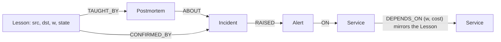

# GhostWalk

Root cause analysis that learns the dependencies nobody drew.

<!-- proof:begin -->
**Evaluated on 30 held-out companies never used for development or tuning; learning starts from zero at each company.**

**Replace graph traversal and it fails: key-value (1 hop) −13.5 pts, vector search −37.6 pts** (top-1 accuracy, HydraDB as the reference;
95% CIs −16.7 to −10.3 and −42.4 to −32.7). GhostWalk gets 76.4% against 38.8% for vector search over postmortem text.

A relational database with recursive queries matches accuracy (+0.0 pts), as expected: the gain comes from multi-hop graph walks, not from which product stores the graph.
We use HydraDB for its native weighted path algorithms. In our latency measurements Postgres is faster, not slower (about 1 ms against 2 to 5 ms per path query once HydraDB's transport was fixed) (see [graph vs SQL](docs/graph-vs-sql.md)).


<!-- proof:end -->

```
make data          # regenerate the simulated dev/test companies (data/ is gitignored)
make eval-quick    # DEV split, ~2 min: PageRank tuning + every headline number -> dev_results.json
make eval          # final TEST run -> results.json, then the real-store swap in docker (eval profile)
make test          # pytest   (web: cd web && npm test)
docker compose up -d --build   # app on :8000 (AUTH_MODE=none opens the demo workspace)
```

If `make` is not installed (Windows), run the commands in the Makefile directly.

## Layout
- `ghostwalk/` engine, learner, in-memory graph, API (`ghostwalk/api`), CLI (`gw`), discovery parsers, GitHub integration
- `gwsim/` simulator, `baselines/`, `eval/` (runner, full eval, PageRank tuning, store swap)
- `web/` React + Vite + TS + Tailwind app; `design/` the hand-off (DESIGN_SPEC.md is the source of truth)
- `results.json` the held-out numbers; the landing strip, Proof page and `gw eval` read it, nothing is hard-coded

## Rules the eval follows
TEST is only touched by final runs. Tuning (PageRank settings) happens on DEV only (`eval/tune_pagerank.py` refuses `test`).

## GitHub App
Read-only: repository contents + issues, subscribe to the Issues event, webhook URL `/api/webhooks/github`.
Env: `GITHUB_APP_ID`, `GITHUB_APP_PRIVATE_KEY`, `GITHUB_APP_SLUG`, `GITHUB_WEBHOOK_SECRET`.
A read-only App cannot open a pull request, so the postmortem-template PR uses `GITHUB_PR_TOKEN` (a token you control);
without it the UI offers a prefilled "new file" link.

## MCP server
`gw mcp` runs a stdio MCP server with six tools: `why(alerts)`, `path(root, service)`, `blast_radius(service, hops=3)`, `why_edge(src, dst)`,
`lesson_impact(lesson_id)` and `propose_edge(src, dst, incident_id, reason)`. All but `propose_edge` are read-only (`why_edge` and `lesson_impact` need `GW_STORE=hydradb`). `propose_edge` only creates a pending proposal
that a person approves in Learn. GhostWalk never calls an LLM; the assistant asks and the graph answers.

Claude Code:
```
claude mcp add ghostwalk -- gw mcp
```
Cursor (`.cursor/mcp.json`) and other clients:
```json
{ "mcpServers": { "ghostwalk": { "command": "gw", "args": ["mcp"] } } }
```
Local mode reads the map saved by `gw` (`GW_HOME`, default `./.gw`). Hosted mode: set `GW_URL` and `GW_TOKEN`
(the API token from Settings) and each call is forwarded to that server.

## Engineering

All numbers below are in `results.json` (TEST split, commit `c116282`). Tuning happens on DEV only; TEST is run once at the end.

### Change evidence (`--use-changes`)
The simulator now emits "what changed recently" events per incident. The true root had a deploy or config change in the 30 minutes before the
first alert with probability `p_root`; distractor changes land on random non-root services at Poisson rate `r_noise`; 10% of timestamps are jittered
by up to ±10 minutes. Change events use their own random stream, so every other field of every incident is byte-identical to the benchmark before
they existed (tested). The engine adds `GAMMA * exp(-minutes_before_first_alert / TAU)` to a candidate's log score. `GAMMA ∈ {0, .25, .5, 1}` and
`TAU ∈ {5, 15, 30}` were searched on DEV only (`eval/tune_changes.py`); the optimum (GAMMA 1, TAU 30) sits on the corner of the grid.

At the defaults (`p_root` 0.5, `r_noise` 2) AC@1 goes 0.764 → 0.782, a gain of **+1.7 pts (95% CI +1.1 to +2.4, paired)**.
The DEV gain was larger (+2.8 pts), so some of it was fitted. Sensitivity of the gain, in AC@1 points (`*` = 95% CI includes 0):

| root has a change \ distractors per incident | 0.5 | 2 | 5 |
|---|---|---|---|
| 20% | +0.8 (+0.3 to +1.3) | +0.4 (-0.0 to +0.9) * | +0.2 (-0.3 to +0.7) * |
| 50% | +1.9 (+1.2 to +2.7) | +1.7 (+1.1 to +2.4) | +1.1 (+0.5 to +1.7) |
| 80% | +3.4 (+2.6 to +4.3) | +3.3 (+2.4 to +4.2) | +2.7 (+2.1 to +3.3) |

**helps only when the root's own change is common: reliable gain (95% CI above 0) for p_root in [0.5, 0.8]; at p_root=0.2 the gain is +0.4 pts with a CI that includes 0. Distractor noise up to r_noise=5 does not remove it at p_root=0.5.** The gain does not vanish at `r_noise` 5 when `p_root` is 0.5, but it is within noise at `p_root` 0.2 with the default noise.
Change evidence is a small, conditional gain. It is off by default and is not on the landing page.

Inputs: `POST /v1/changes` `{service, ts, kind, ref}`, a GitHub `deployment_status` / `release` webhook, and `gw change add SERVICE --ref '#482'`.
With the flag on, the verdict explains itself: "config-svc changed 1 min before the first alert (deploy #482)", and the MCP `why` returns the same line.

### Pre-deploy blast radius: `gw diff`
```
gw export > graph.json                       # official + learned graph and incident roots
gw diff --base main --head HEAD --graph graph.json [--format markdown|json]
```
It parses compose, k8s, Helm and `*_URL` / `*_HOST` evidence at both refs with the onboarding parser, lists added and removed edges, and for each added
edge asks the current graph how many services sit upstream of the new dependency, whether a learned edge already touches it, and which incidents it caused.
Read-only and offline: with a graph export file it needs no token or network.


GitHub Action (`.github/actions/ghostwalk-diff`), one comment updated in place and never duplicated (the extra-duplicate healing is tested):
```yaml
- uses: actions/checkout@v4
  with: { fetch-depth: 0 }
- uses: ./.github/actions/ghostwalk-diff
  with: { graph: graph.json }
```
Example comment (snapshot-tested): `+ fraud-check → config-svc · new dependency · blast radius 4 services (fraud-check, payments, checkout-api, web-edge) · a learned edge already touches it · config-svc caused INC-0931, INC-1042`

### Numbers for "Search vs walk"
- LLM tokens per verdict: ghostwalk **0**, TF-IDF **0** (neither calls a model). No LLM baseline was run, so there is no number for one.
- Verdict latency, in-memory: p50 0.2 ms, p95 0.8 ms. Via HydraDB: **not measured** (no node has answered; the adapter's response parser is still a stub).
- Novel vs repeat incidents AC@1: ghostwalk 0.704 novel / 0.845 repeat, learning off 0.686 / 0.662, TF-IDF 0.214 / 0.692.

### Agent benchmark (stretch): not run
It needs an LLM API key and spend, and none is configured here, so there is no result and nothing is claimed about it.

## Performance
`make bench` (`python eval/bench.py --reference`) times the verdict on synthetic graphs of 100 / 1,000 / 5,000 services, 1,000 incidents each, with the
same tier mix as the benchmark, and writes the `latency` section of `results.json` (in-memory engine, full online loop with learning).

| services | p50 | p95 | p99 | previous walk loop p95 |
|---|---|---|---|---|
| 100 | 0.6 ms | 0.8 ms | 1.1 ms | 2.1 ms |
| 1,000 | 15.0 ms | 22.0 ms | 30.4 ms | 59.1 ms |
| 5,000 | 84.6 ms | 116.4 ms | 125.9 ms | 422.3 ms |

Both gates are met without a rewrite: p95 at 1,000 services is under 100 ms, and p95 at 5,000 services is under 250 ms, so there is **no Rust port** and
no `ghostwalk-fast` wheel. The hygiene that did it: adjacency built once per graph revision and cached (invalidated by every learner write), a per-verdict
memo, hoisted constants, and a candidate loop that visits only the services a candidate can reach. A parity test keeps the old `walk()` as a reference and
checks that every incident of every dev and TEST company ranks the same (scores equal to 1e-9) through the whole learning loop, allowing exact ties to reorder. The loop change did
reorder exact ties (the top-1 count moved 1379 to 1380), so ties are now broken deterministically (equal to 9 decimals, then lowest component id), the TEST run was repeated once
with that final engine, and every table in `results.json` comes from it (see the accuracy history in the HydraDB section). Profiling also showed the limited Bellman-Ford was only about 15% of a 5,000-service verdict, so porting just that function
would not have met the 250 ms line anyway.

Not done at scale: HydraDB-backed latency on the 100/1,000/5,000-service graphs (its latency on the TEST companies is in the HydraDB section), and UNWIND batching of HydraDB path queries, which this HydraDB version does not allow for edge writes (no batch shape writes edge properties).
Path costs (-ln w) were already stored with w on every HydraDB write, and results.json is now parsed once per file version.

<!-- memory:begin -->
## The memory is the graph
**GhostWalk's learning loop lives in HydraDB: every lesson is a node linked to the postmortems that taught it and the incidents that confirmed it.**
The learner reads and writes through the HydraDB repository layer; the in-memory graph is a cache that is rebuilt from HydraDB by revision (`GW_STORE=hydradb`).



`state` is tentative, confirmed or decayed. Every node carries the company key. A lesson's weight is written together with its `DEPENDS_ON` edge.

**Why does the map say `experiment-svc` depends on `ledger-db`?** One traversal, `gw why-edge experiment-svc ledger-db` (also `GET /v1/edges/{src}/{dst}/why` and an MCP tool):

```
$ gw why-edge experiment-svc ledger-db

  experiment-svc -> ledger-db   w 0.70  learned  2 confirmations

  lesson L153  confirmed  w 0.70  created at revision 4
    taught by   INC-1004  root ledger-db  path experiment-svc -> ledger-db
    confirmed   ✓ INC-1018

  gw why-edge answers by traversal: Lesson -> Postmortem -> Incident, in HydraDB
```

`GET /v1/lessons/{id}/impact` answers the other way round: the services and past incidents whose paths use a learned edge.

**Persistence.** Twenty incidents were learned through the API with GW_STORE=hydradb; the API process was killed and its state file deleted; a new process re-attached to HydraDB and ranked incident 21 identically (all 5 candidates, names and confidences) (`scripts/persistence_demo.py`, transcript in `docs/measurements/persistence_demo.txt`). The same holds in a test that also compares against the in-memory learner.

**Graph memory against vector memory** (30 held-out companies, online, only past incidents of the same company; top 5; paired cluster bootstrap, 95% CIs in brackets).
The graph arm uses no alert text: it traverses HydraDB from the alerting services (2 hops, both directions) to the past incidents that alerted on that neighbourhood, ranked by overlap.

| | graph (HydraDB) | vector (pgvector) | keyword (TF-IDF) |
|---|---|---|---|
| hit@5, repeat incidents (n=1175) | 84.3% [82.1, 86.7] | 87.3% [85.0, 89.3] | 89.5% [87.5, 91.5] |
| MRR, repeat incidents | 0.709 [0.674, 0.744] | 0.721 [0.697, 0.745] | 0.746 [0.718, 0.770] |
| related@5, novel incidents (n=595) | 20.2% [17.3, 23.3] | 24.5% [20.4, 28.5] | 25.4% [21.4, 29.1] |
| related@5, all (n=1770) | 51.0% [46.1, 56.4] | 54.6% [49.8, 59.5] | 54.2% [50.1, 58.8] |
| retrieval latency p50 / p95 | 3.9 / 7.5 ms | 1.3 / 1.8 ms | 0.6 / 1.0 ms |

On repeat incidents, hit@5: graph is behind vector (−3.0 pts, 95% CI −5.8 to −0.1); graph is behind keyword (−5.2 pts, 95% CI −8.0 to −2.4). MRR: graph is not distinguishable from vector (−1.3 pts, 95% CI −5.2 to +2.9).
On novel incidents (no past incident shares the root, so hit@5 cannot exist), related@5 asks whether a retrieved incident's true causal chain shares a dependency with the current one: graph is behind vector (−4.4 pts, 95% CI −6.8 to −2.0).
hit@5 needs a past incident with the same root; 1175 of 1770 incidents have one, and the first incident of each company has nothing to retrieve from.
Graph retrieval first took 164 ms p50 / 424 ms p95 (a HydraDB query per step); it now expands the neighbourhood on the revision-checked cached graph, keeps a per-revision service-to-incidents index current through the write-through path, and fetches only the winners from HydraDB by id: 3.9 / 7.5 ms, with all 1,770 retrieved lists identical to the first implementation's (accuracy numbers unchanged).
The LLM arms were not run (no API key), so there is no `llm_graph_memory` number. Full definitions and CIs: `results.json` `memory_retrieval`.
<!-- memory:end -->

<!-- notwin:begin -->
## What didn't win
**Graph memory did not beat ordinary retrieval at finding similar past incidents.** On the 30 held-out companies, retrieving the 5 most relevant past incidents
(hit@5: a retrieved incident has the same root cause, repeat incidents only, n=1,175; 95% CIs in brackets):

| | hit@5 | MRR | latency p50 / p95 |
|---|---|---|---|
| keyword (TF-IDF) | 89.5% [87.5, 91.5] | 0.746 | 0.6 / 1.0 ms |
| vector (pgvector) | 87.3% [85.0, 89.3] | 0.721 | 1.3 / 1.8 ms |
| graph (HydraDB memory) | 84.3% [82.1, 86.7] | 0.709 | 3.9 / 7.5 ms |

graph is behind keyword (−5.2 pts, 95% CI −8.0 to −2.4); graph is behind vector (−3.0 pts, 95% CI −5.8 to −0.1). Looking up similar past incidents is easy in this setting: a repeat incident usually alerts on the same
services, so a bag-of-words match on the alert text finds it, and nothing about the graph helps. **The graph matters for root-cause ranking, which is a different job.** On the same held-out
incidents the multi-hop walk gets top-1 accuracy 0.764, against 0.419 for TF-IDF retrieval of past postmortems and 0.388 for vector search over them,
and replacing the graph with a 1-hop key-value store drops it to 0.629 (the store swap, below). HydraDB is where the graph and its memory live and it answers path queries in a few
milliseconds, but Postgres with recursive queries gets the same accuracy and answers faster: we do not claim HydraDB or graph retrieval beats vector search or Postgres.
<!-- notwin:end -->

## Deploy
Backend (HydraDB + API + HTTPS) on a Linux VM, frontend on Vercel: see [docs/deploy.md](docs/deploy.md). `deploy/setup.sh` brings the backend up and runs `deploy/smoke.py`;
`gw doctor` checks a running stack. Not deployed yet: there is no live URL to link here.

## HydraDB (live)
GhostWalk runs against HydraDB's own published image, `ghcr.io/hydra-db/hydradb:0.4.0` (the one `charts/hydradb` references): `docker compose up -d hydradb`.
(If you restart the container, remove its volume first, `docker compose down hydradb -v`: a restarted node rejects writes whose request ids it has seen.)
`ghostwalk/graph/hydra.py` is written against the dialect in `USING-HYDRADB.md` and checked on a live node: edgeless nodes need the node batch, writes accept only one-hop
edge patterns, `MERGE` cannot be followed by another clause so weight changes are `MATCH ... SET`, no batch shape writes edge properties (each edge is one request, about
65 ms), results are **paginated** (default 1,024 rows; the adapter follows `next_cursor` to the end), `algo.SPpaths` minimises `weightProp` while `costProp` is only
the cost it reports, and `algo.MSpaths` selects by a property shared across companies, so each node carries a per-company `key`.

- **Parity:** the HydraDB-vs-in-memory tests (`tests/test_parity.py`, 8) check identical rankings and scores, identical final graph state, path costs equal to the in-memory best path,
  the cache re-reading only when the revision changes, and in-DB verdicts matching in-memory rankings.
- **How HydraDB is used:** Verdicts read from HydraDB through a revision-checked write-through cache; path computation runs in the engine. HydraDB in-DB path mode is slower at these sizes (measured), so it is not used.
  The cache is write-through: when the learner writes to HydraDB the identical change (the learner's own `update.apply`) is applied to the cached graph in the same step, and the revision
  HydraDB reports is checked; a verdict is never served from a cache whose revision is behind HydraDB's, and the whole graph is re-read only if the revisions disagree. On the 30 TEST companies
  (1,800 incidents, learning on) that was **2.3 ms p50 / 3.8 ms p95 per verdict with 0 full re-reads**, against
  49 / 89 ms before the cache; accuracy unchanged. The learning write itself (the graph change plus the memory: the incident, its alerts, the postmortem and the lessons with their links, a few dozen sequential HydraDB requests) takes
  403 ms p50 / 1071 ms p95, off the verdict path.
- **Why it was 48 ms per request, and the fix:** HydraDB answers in 0.1 to 0.9 ms (its own `/metrics` histogram) and its response arrives in one read. Clients that write the request headers
  and body separately (httpx, http.client, HTTP/2) took ~45 ms through Docker Desktop's published port on Windows, the same clients inside the docker network took 0.3 to 1.5 ms, and a client
  that sends headers and body in one write took 0.4 ms through the same port (so did Bolt). Client-side `TCP_NODELAY` did not help. The adapter now uses a persistent connection with one write per request
  (`ghostwalk/graph/fasthttp.py`); data in `docs/measurements/`, full results in `results.json` `ops.hydradb_latency.diagnosis`.
- **Warm latency after the fix** (this laptop: Windows-11-10.0.26300-SP0, 16 CPUs, 7.6 GB; client on the host, HydraDB and Postgres in docker; 200 timed requests after 20 warm-up; p50 / p95 ms):

| | HydraDB | Postgres |
|---|---|---|
| 1-hop neighbours | 2.7 / 3.8 | 0.3 / 0.5 |
| best path, 3 hops | 0.5 / 0.8 | 0.4 / 0.5 |
| best path, 5 hops | 0.6 / 1.0 | 0.5 / 0.7 |
| edge-weight write | 23 / 24 | 0.8 / 1.1 |
| verdict: cached hit | 1.8 / 2.9 | |
| verdict: cached miss (every incident in the online loop) | 36 / 66 | |
| verdict: cold read | 40 / 64 | |
| verdict: in-DB (two `MSpaths`) | 144 / 269 | |
| verdict: Postgres, two batched CTEs | | 2.8 / 4.3 |

  HydraDB's verdict p50 is under 20 ms only on a **cache hit** (1.8 ms); a miss or cold read is 40 to 36 ms, and an in-DB verdict
  144 ms. In-DB verdicts matched the in-memory engine in 180/180 cases. Before the fix: cold p50 / p95 was
  289 / 328 ms. HydraDB writes still cost about 23 ms each (server-side commit), so loading and learning are the slow part.
- **Path queries at scale, after the transport fix** (synthetic graphs, same generator; p50 / p95 ms; both stores return the exact same cost every time; before the fix HydraDB read about 48 ms at every size):

| services | HydraDB 3 hops | Postgres 3 hops | HydraDB 5 hops | Postgres 5 hops | whole verdict p50: HydraDB read / in-DB / Postgres |
|---|---|---|---|---|---|
| 100 | 1.7 / 2.9 | 0.4 / 0.8 | 2.1 / 3.5 | 0.4 / 0.8 | 40 / 234 / 3.5 |
| 1000 | 5.4 / 11 | 1.0 / 4.1 | 3.0 / 5.8 | 0.8 / 1.7 | 475 / 1905 / 12 |
| 5000 | 4.1 / 6.5 | 0.5 / 0.8 | 3.2 / 7.6 | 0.5 / 0.6 | 2472 / 97623 / 210 |

  **Postgres is still faster at every size** (under 1 ms to about 1 ms per path against 2 to 5 ms for HydraDB; no CTE blow-up at 5 hops on these graphs). Pushing the whole verdict into HydraDB is slower than reading
  the graph back, and at 5,000 services `MSpaths` needs several requests to stay under its 64 MB response buffer. HydraDB's role here is native weighted path algorithms, not speed or accuracy.
  Side-by-side queries and round trips: [docs/graph-vs-sql.md](docs/graph-vs-sql.md).

Store swap on the TEST split, run once, same incidents, ΔAC@1 against HydraDB:

| store | AC@1 | ΔAC@1 (95% CI, pts) | p50 | p95 |
|---|---|---|---|---|
| HydraDB v0.4.0 (published image) | 0.764 | reference | 2.3 ms | 3.8 ms |
| Postgres recursive CTE | 0.764 | +0.0 (+0.0 to +0.0) | 17.4 ms | 71.8 ms |
| Key-value, 1 hop (Redis) | 0.629 | −13.5 (−16.7 to −10.3) | 40.2 ms | 61.0 ms |
| pgvector nearest postmortem | 0.388 | −37.6 (−42.4 to −32.7) | 44.6 ms | 48.1 ms |
| In-memory graph | 0.764 | +0.0 (+0.0 to +0.0) | 0.2 ms | 0.7 ms |

- **Accuracy history on TEST (top-1 hits of 1,800):**
  - before the walk-loop optimisation (commit f8bf9a8): 1379/1800 top-1 hits (0.7661)
  - after the optimisation: tied scores ordered by float summation order (store-swap run, commit 3c43bab): 1380/1800 top-1 hits (0.7667)
  - final: deterministic tie-break (scores equal to 9 decimals, then lowest component id): 1376/1800 top-1 hits (0.7644)
  Every table in `results.json` now comes from the final engine.
