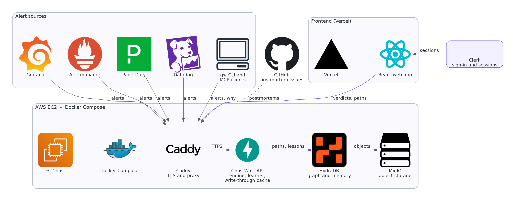
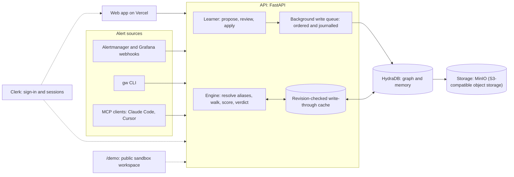
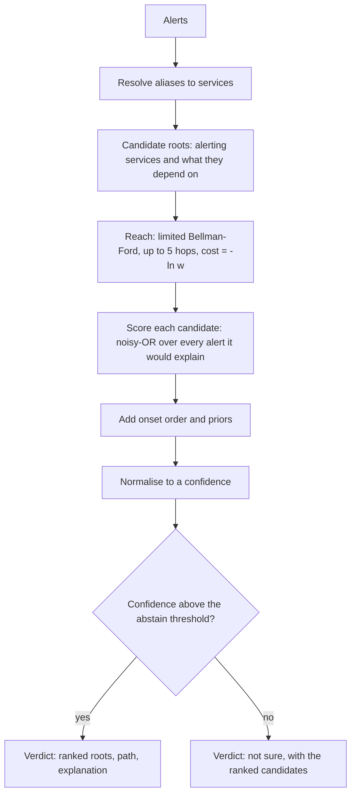
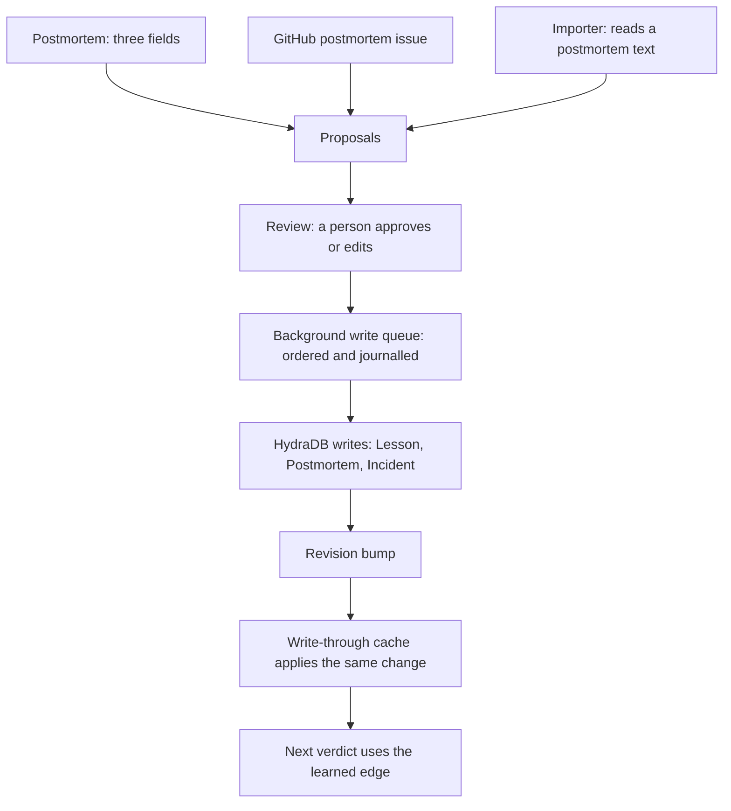
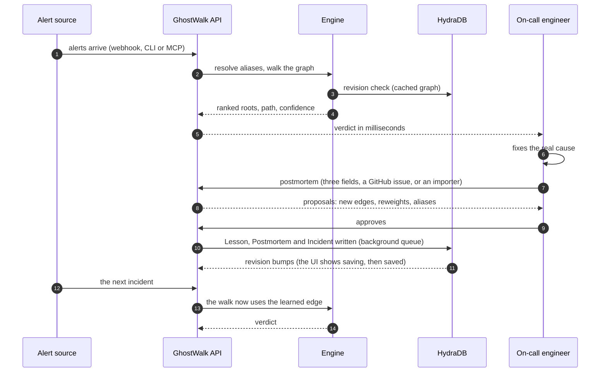
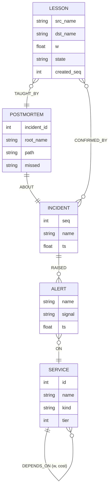
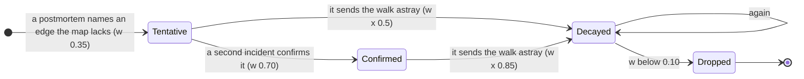

# Architecture

High-level design first, then the low-level design of each part, then the decisions behind them. Generated from `docs/templates/ARCHITECTURE.tpl.md` and `results.json`.

## High-level design

Alerts come from Grafana, Alertmanager, PagerDuty and Datadog webhooks, the `gw` CLI and MCP clients. Caddy terminates TLS in front of the GhostWalk API on an AWS EC2 host running Docker Compose. The API holds the engine, the learner and the write-through cache, and keeps the graph and the memory in HydraDB, whose data is on MinIO. The React app on Vercel calls the same API; Clerk issues the sessions. GitHub is a source of postmortem issues. The picture is built by `scripts/render_architecture.py` (Graphviz and the `diagrams` library, with HydraDB as a custom node).

## Components

The same system as a flow:

- **Engine** (`ghostwalk/engine/`): resolves alert names to services (through aliases), walks the weighted dependency graph from the alerting services, scores candidate roots (noisy-OR over paths, with priors for roots seen before and for silent services), and returns a ranking, a confidence and a path. Frozen: changes to scoring need a DEV result and a new declared test run.
- **Learner** (`ghostwalk/learn/`): turns a postmortem (root, causal chain, aliases) into a list of plain graph operations: add a tentative edge, confirm it, reweight, drop, alias, count a root, record a shortcut. The same operations are shown for review, applied in memory, or written to HydraDB.
- **Graph adapter** (`ghostwalk/graph/hydra.py`): the only code that speaks HydraDB. It writes the graph and the learner's memory, and serves the engine a cached `GraphState`.
- **API** (`ghostwalk/api/`): FastAPI. A workspace holds the graph cache, incidents and pending proposals; in multi-user mode every signed-in user has their own workspace and the public demo is one more.

## Low-level design

### The engine

Alert names are resolved to services through aliases; anything that does not resolve is reported as unresolved, not guessed. For each candidate root the engine takes the best reach to every alerting service within five hops, where a path's cost is the sum of `-ln w` over its edges (the product of weights, as a shortest path). The score is a noisy-OR likelihood: a candidate is rewarded for every alert it would explain and penalised for the ones it should have caused but did not, with the onset order of the alerts and priors for roots seen before added in. Scores are normalised to a confidence. Below the abstain threshold the verdict says it is not sure and still lists the ranked candidates.

### The learner

A postmortem, a GitHub issue or the importer produces proposals (add an edge, confirm one, reweight, drop, alias). A person reviews them. Approved changes go to one ordered background queue; each is written to HydraDB, the revision bumps, and the write-through cache applies the identical change, so the next verdict already uses the lesson.

### One incident, end to end

### The schema in HydraDB

Services carry `DEPENDS_ON` edges with a weight and a cost. An incident `RAISED` alerts that are `ON` services. A postmortem is `ABOUT` an incident. A lesson was `TAUGHT_BY` a postmortem and is `CONFIRMED_BY` the incidents that confirmed it. `gw why-edge` walks Lesson to Postmortem to Incident.

### Lesson lifecycle

With 10% of postmortems deliberately wrong, learning still adds +8.9 pts (95% CI +5.7 to +12.3). On this benchmark, removing the guard changes top-1 accuracy by +0.3 pts, inside the noise, so no benefit from it is measured here.

## Where HydraDB sits

HydraDB holds the dependency graph (services, `DEPENDS_ON` edges with weight and cost) and the learner's memory (incidents, alerts, postmortems and lessons, linked by `RAISED`, `ON`, `ABOUT`, `TAUGHT_BY` and `CONFIRMED_BY`). Path computation runs in the engine, on a copy of the graph held in memory: reading paths out of HydraDB with its native `SPpaths` and `MSpaths` queries was implemented, checked for identical results, measured and found slower at these sizes, so it is not used for verdicts. Its path queries are still how the parity tests and the scale benchmark check the engine.

## The revision-checked write-through cache

Reading the whole graph from HydraDB for every verdict would make every verdict slow (see the cold-read row in [PERFORMANCE.md](PERFORMANCE.md)). Instead:

1. HydraDB keeps one revision number per company, bumped by every learner write as its last statement.
2. A verdict reads that one number (an id-anchored read) and serves the cached graph only if the number matches the cache's. A cache that is behind HydraDB is never served.
3. When the learner writes, the adapter applies the identical change to a copy of the cached graph (the learner's own `apply`), then reads back the revision HydraDB reports. If it matches, the cache moves to the new revision; if it does not (another writer, a failed write), the cache is dropped and the next verdict re-reads the whole graph.
4. A per-revision index (service to past incidents) is kept the same way, so graph-memory retrieval needs no scan.

## Writes are asynchronous, ordered and replayable

Applying a postmortem returns as soon as the request is validated and journalled. One background writer commits the graph change and the memory to HydraDB in order; the revision bumps when a job completes, and the UI shows "saving" until it does. Verdicts meanwhile read the last committed graph, so they never see a half-written lesson.

The journal lives in the workspace's state file. Before a job's first HydraDB write, its operations are fixed with absolute values (the confirmation count, the root counter, the shortcut count it will end up with), so replaying a job that died half-way writes the same values again instead of counting twice. On start the API finishes the journal before it serves anything. `tests/test_async_learning.py` covers ordering, a crash before the queue ran, and a crash in the middle of a job.

## Storage

HydraDB writes to an object store. In production that is MinIO (S3-compatible), internal to the Docker network and persisted on its own volume; HydraDB's local volume is only a cache. HydraDB's writer leases and manifest pointer need conditional writes, which MinIO supports; HydraDB checks this at start. Deleting HydraDB's local data and restarting returns the same graph from object storage (`make durability-demo`).

HydraDB 0.4.0 numbers HTTP requests from one on every start and deduplicates writes durably by that number, which made every write fail after a restart. Every request now carries its own unique `query_id`: [hydradb-issue.md](hydradb-issue.md).

## Accounts and isolation

Clerk issues the sessions. The API verifies each session token against Clerk's cached signing keys (signature, expiry, not-before, issuer, and the authorised party when present) and maps the Clerk user to a workspace. A workspace has its own state file and its own range of HydraDB ids, and every scan filters on its own company key. Workspace API tokens (`gw_live_<workspace>_<secret>`) are shown once and stored hashed. `/demo` is a separate public sandbox workspace: settings, onboarding and webhooks are read-only there and it is rebuilt every night. `tests/test_tenancy.py` checks the isolation, including two workspaces on one HydraDB.

## Deployment

A Linux VM runs HydraDB (pinned image), MinIO, the API and Caddy (HTTPS); the web app is on Vercel and calls the API with a CORS allow-list. `deploy/setup.sh` brings the backend up and runs the smoke test; see [deploy.md](deploy.md).
