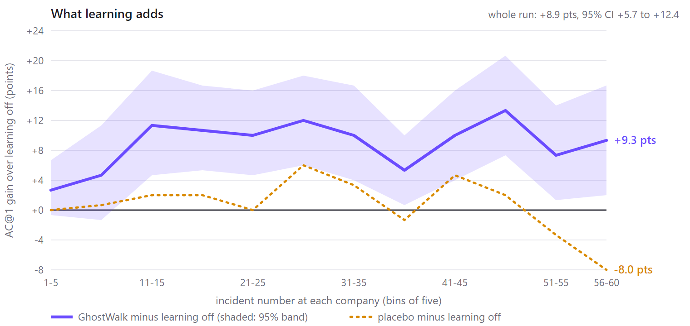

# Evaluation method

Generated from [`results.json`](../results.json) by `scripts/update_readme_numbers.py`. The short version is in the README; this is the full method and every table.

## What is measured

For each incident of a company, in order: the verdict is computed from the alerts and the graph as it stands, scored against the true root (top-1 and top-3), and only then the incident's postmortem is learned from. Learning starts from zero at every company. The primary metric is top-1 accuracy (AC@1) over 1,800 incidents of 30 held-out companies, with 95% intervals from a paired cluster bootstrap over companies (2,000 draws, fixed seeds recorded in `results.json`).

## The simulator

`gwsim` generates companies from three families: **hub** (a few shared services everything leans on), **layered** (tiers from edge to infrastructure), and **real** (topologies shaped like published microservice systems; two of the three follow RCAEval's systems, no RCAEval data is used). Each company has an official map that is missing edges (hidden dependencies: generated files, shared config, permissions), aliases (alerts name a service differently from the map), silent services, and postmortems that are sometimes wrong. Defaults of every knob:

| knob | default |
|---|---|
| hidden_frac | 0.2 |
| alias_frac | 0.15 |
| miss_rate | 0.15 |
| silent_root | 0.2 |
| spurious | 0.01 |
| monitor_blind | 0.05 |
| wrong_pm | 0.1 |
| n_incidents | 60 |
| p_root_change | 0.5 |
| r_noise | 2.0 |
| change_jitter | 0.1 |

## Main results

| method | AC@1 [95% CI] | AC@3 [95% CI] | mean checks to root |
|---|---|---|---|
| **GhostWalk (multi-hop walk + learning)** | 76.4% [74.5, 78.6] | 90.7% [89.0, 92.1] | 2.00 |
| GhostWalk, learning off | 67.6% [63.6, 71.5] | 84.2% [80.7, 87.5] | 2.39 |
| GhostWalk, placebo postmortems | 68.2% [64.7, 71.7] | 82.7% [78.6, 86.4] |  |
| GhostWalk on the true graph (oracle) | 82.9% [80.7, 85.2] | 94.8% [93.8, 95.7] |  |
| Personalized PageRank (tuned on DEV) | 69.9% [66.7, 73.0] | 83.6% [80.6, 86.1] | 3.04 |
| Personalized PageRank (untuned default) | 49.6% [45.9, 53.4] | 66.4% [62.3, 70.5] |  |
| TF-IDF retrieval of past postmortems | 41.9% [37.4, 46.8] | 59.2% [53.9, 65.0] | 3.42 |
| Deepest alerting service | 65.8% [62.8, 68.7] | 71.4% [68.2, 74.4] | 2.49 |
| Random | 21.2% [18.6, 24.0] | 48.7% [45.2, 52.6] |  |
| GhostWalk + change evidence (`--use-changes`) | 78.2% [76.2, 80.3] | 92.1% [90.6, 93.5] |  |

Learning starts from zero at each company. Intervals are paired cluster bootstraps over companies (2,000 draws). Against the best baseline, GhostWalk is +6.5 pts (95% CI +3.6 to +9.8) ahead and closes 58% of the gap to the perfect-map oracle.

## How GhostWalk compares

Same incidents, same engine and learner; only the store changes for the store rows.

| approach | AC@1 (95% CI) | Δ vs GhostWalk | verdict p50 / p95 | tokens per verdict | learns from postmortems? |
|---|---|---|---|---|---|
| **GhostWalk on HydraDB** | 76.4% [74.5, 78.6] | reference | 2.3 ms / 3.8 ms | 0 | yes: lessons in HydraDB, linked to evidence |
| Same engine on Postgres (recursive CTE) | 76.4% [74.5, 78.6] | +0.0 pts (95% CI +0.0 to +0.0): matches accuracy; the gain comes from multi-hop graph walks; Postgres is faster on raw path queries at our sizes | 17 ms / 72 ms | 0 | yes |
| Same engine in memory (no store) | 76.4% [74.5, 78.6] | +0.0 pts (95% CI +0.0 to +0.0) | 0.21 ms / 0.74 ms | 0 | yes |
| Key-value store (Redis), 1 hop | 62.9% [59.7, 66.2] | −13.5 pts (95% CI −16.7 to −10.3) | 40 ms / 61 ms | 0 | yes, 1 hop only |
| Vector search over postmortems (pgvector) | 38.8% [34.5, 43.4] | −37.6 pts (95% CI −42.4 to −32.7) | 45 ms / 48 ms | 0 | adds text, no graph |
| Keyword retrieval (TF-IDF) of past postmortems | 41.9% [37.4, 46.8] | −34.6 pts (95% CI −39.2 to −29.7) | 0.64 ms / 1.6 ms | 0 | adds text, no graph |
| Deepest alerting service | 65.8% [62.8, 68.7] | −10.7 pts (95% CI −13.9 to −7.8) | 0.02 ms / 0.09 ms | 0 | no |
| Personalized PageRank (tuned on DEV) | 69.9% [66.7, 73.0] | −6.5 pts (95% CI −9.8 to −3.6) | 0.32 ms / 0.56 ms | 0 | no |
| Random | 21.2% [18.6, 24.0] | −55.2 pts |  | 0 | no |
| GhostWalk with learning off | 67.6% [63.6, 71.5] | −8.9 pts (95% CI −12.4 to −5.7) |  | 0 | no (the learning proof) |
| GhostWalk with placebo postmortems | 68.2% [64.7, 71.7] | −8.2 pts (95% CI −11.4 to −5.4) |  | 0 | learns noise (the learning proof) |
| LLM, plain (n=58 subset) | 56.9% [42.1, 71.7] | −15.5 pts (95% CI −27.3 to −3.4) on the subset | 1,537 ms / 3,801 ms | 2,068 | no |
| LLM + memory (five past postmortems) (n=58 subset) | 67.2% [53.4, 81.0] | −5.2 pts (95% CI −15.3 to +5.2) on the subset | 1,674 ms / 4,353 ms | 2,285 | no |

1. **Graph traversal is what matters.** Replacing it with a 1-hop key-value store costs 13.5 points of top-1 accuracy and vector search over the same postmortems costs 37.6.
2. **Postgres ties on accuracy** (difference +0.0 points, 95% CI +0.0 to +0.0): the gain comes from multi-hop graph walks, not from which product stores the graph; Postgres is faster on raw path queries at our sizes (HydraDB 3.2 ms vs Postgres 0.48 ms for 5 hops at 5000 services).
3. **The LLM costs tokens and seconds per verdict.** On the 58-incident subset (the first 58 of 100 planned incidents, 17 of the 30 companies: the run stopped at the model API's daily token quota) it used about 2,068 tokens and 1,537 ms p50 per verdict (GhostWalk: none, 2.3 ms). On the same incidents GhostWalk scored 72.4% [63.8, 81.4]: ahead of the plain LLM (56.9% [42.1, 71.7]; difference +15.5 points, 95% CI +3.4 to +27.3) and not distinguishable from the LLM given five past postmortems (67.2% [53.4, 81.0]; difference +5.2 points, 95% CI -5.2 to +15.3). These intervals are wide: this is a comparison on a small, partly covered subset, not a verdict on LLMs.
4. **GhostWalk's learning lives in HydraDB**: every lesson is a node linked to the postmortem that taught it and the incident that confirmed it, and it survives restarts (durability demo, async write queue with replay).

## Splits and rules

- **DEV** is where everything is tuned: the PageRank baseline's grid, the change-evidence weights, the engine settings. **TEST** (30 companies, never used for development or tuning) is used for declared runs only, and each run is recorded.
- **The rerun history, in full.** The test split's top-1 hits moved as below. The first change reordered exact ties after a speed optimisation; the second added a deterministic tie-break (equal scores are ordered by component id). Every table in `results.json` comes from the final engine.

| engine | top-1 hits |
|---|---|
| before the walk-loop optimisation (commit f8bf9a8) | 1379 of 1,800 |
| after the optimisation: tied scores ordered by float summation order (store-swap run, commit 3c43bab) | 1380 of 1,800 |
| final: deterministic tie-break (scores equal to 9 decimals, then lowest component id) | 1376 of 1,800 |

## Controls and baselines

- **Learning off** (the same engine, no learner), **placebo postmortems** (a random root and random edges: same shape, no information) and the **perfect-map oracle** bracket the learning proof.
- **Baselines:** deepest alerting service; personalised PageRank, tuned on DEV for fairness (72 settings on DEV (restart [0.05, 0.1, 0.15, 0.25, 0.35, 0.5], direction ['dep', 'rev', 'both'], weighted [True, False], onset [False, True]); chosen {'restart': 0.5, 'direction': 'dep', 'weighted': True, 'onset': True}; DEV AC@1 70.0% tuned against 44.0% untuned.); TF-IDF retrieval of past postmortems; random. The best baseline on TEST by AC@1 is reported (it favours the baseline).
- **Stores:** the same engine and learner on HydraDB, Postgres (recursive CTE), a 1-hop key-value store and in memory; vector search (pgvector) over postmortem text. Only the store changes.
- **Poisoning:** the simulator is rerun with deliberately wrong postmortems at several rates.
- **LLM baseline.** LLM baseline: Gemini with Groq fallback on rate limits (model recorded per incident). GhostWalk itself uses no LLM. 58 incidents, stratified by company and incident index with a fixed seed, saved before any call (`eval/llm_subset.json`). Two arms: plain (alerts in firing order and the official map as text) and memory (plus the five most similar past postmortems of that company by TF-IDF, never a future one). Temperature zero, strict JSON, one retry on bad JSON then a miss; every response is cached in `eval/llm_cache/` with provider and exact model id. The free-tier Gemini quota ran out part-way, so later incidents were answered by the Groq fallback: that is stated per incident, not hidden.

| method | AC@1 (95% CI) | Δ AC@1 vs GhostWalk | AC@3 (95% CI) | tokens / incident | latency p50 / p95 | invalid output | provider share |
|---|---|---|---|---|---|---|---|
| GhostWalk | 72.4% [63.8, 81.4] | reference | 82.8% [72.9, 91.7] | 0 |  |  |  |
| GhostWalk, learning off | 63.8% [52.6, 74.6] | −8.6 pts (95% CI −17.2 to −1.7) | 79.3% [70.2, 87.9] | 0 |  |  |  |
| TF-IDF retrieval | 31.0% [15.8, 47.6] | −41.4 pts (95% CI −58.2 to −25.0) | 43.1% [29.6, 57.6] | 0 |  |  |  |
| LLM, plain | 56.9% [42.1, 71.7] | −15.5 pts (95% CI −27.3 to −3.4) | 65.5% [54.8, 76.3] | 2,068 | 1,537 ms / 3,801 ms | 0% | Gemini 17%, Groq 83% |
| LLM + memory | 67.2% [53.4, 81.0] | −5.2 pts (95% CI −15.3 to +5.2) | 74.1% [62.5, 85.5] | 2,285 | 1,674 ms / 4,353 ms | 0% | Gemini 16%, Groq 84% |

LLM baseline: Gemini with Groq fallback on rate limits (model recorded per incident). GhostWalk itself uses no LLM. 58 incidents across 17 companies, chosen with a fixed seed and saved to `eval/llm_subset.json` before any call: three per company (one each from the early, middle and late third of its incidents, never the first), plus a fourth for ten seeded companies. Models used (recorded per incident in `eval/llm_cache/`): gemini-3.6-flash, openai/gpt-oss-120b. temperature 0, strict JSON, one retry on bad JSON then a miss. The run stopped when Groq's free daily token limit was reached: these are the first 58 of the 100 planned incidents in company order (17 of 30 companies; families covered: hub, layered; not reached: real); `python eval/llm_baseline.py` resumes from the cache once the limit resets.

## Learning proof

| variant | AC@1 [95% CI] |
|---|---|
| GhostWalk, learning off | 67.6% [63.6, 71.5] |
| GhostWalk, placebo postmortems | 68.2% [64.7, 71.7] |
| GhostWalk (multi-hop walk + learning) | 76.4% [74.5, 78.6] |
| GhostWalk on the true graph (oracle) | 82.9% [80.7, 85.2] |

Learning gain over learning off: +8.9 pts (95% CI +5.7 to +12.4). Placebo postmortems (a random root and random edges, same shape, no information) move accuracy by +0.7 pts: the gain is the content of the postmortems, not the act of learning.

Over the whole run the placebo is +0.7 pts against learning off. By incident number it is not flat everywhere: in the last bin of five (incidents 56 to 60) the placebo is −8.0 pts against learning off (95% CI -14.7 to -2.0), so by then learning from random postmortems has hurt; we did not isolate why. GhostWalk's gain in the same bin is +9.3 pts (95% CI +2.0 to +16.7). The per-bin bands are paired company bootstraps over the per-company tables stored under `learning_curve.paired_gain.tables`.

| learning step removed | AC@1 [95% CI] | change vs full learner |
|---|---|---|
| hidden-edge discovery | 74.0% [71.6, 76.6] | −2.4 pts |
| reweighting | 76.4% [74.3, 78.6] | −0.1 pts |
| aliases | 73.6% [71.2, 76.3] | −2.8 pts |
| shortcuts | 76.2% [74.2, 78.4] | −0.2 pts |
| guard (tentative until confirmed) | 76.8% [74.9, 78.9] | +0.3 pts |
| blind-spot counters | 76.8% [74.8, 79.0] | +0.4 pts |

## Other results

**Walk depth:**

| max hops | AC@1 [95% CI] |
|---|---|
| 1 | 62.9% [59.7, 66.2] |
| 2 | 73.7% [71.7, 75.8] |
| 3 | 76.3% [74.4, 78.3] |
| 4 | 76.3% [74.3, 78.4] |
| 5 | 76.4% [74.5, 78.6] |

**Poisoning:**

| wrong postmortems | GhostWalk AC@1 | learning off AC@1 | gain from learning |
|---|---|---|---|
| 10% | 76.4% [74.4, 78.7] | 67.6% [63.6, 71.5] | +8.9 pts (95% CI +5.7 to +12.3) |
| 20% | 76.3% [73.8, 78.6] | 65.4% [61.5, 69.4] | +10.8 pts (95% CI +7.6 to +14.2) |
| 32% | 74.3% [71.4, 77.0] | 66.1% [63.4, 68.8] | +8.2 pts (95% CI +5.4 to +11.4) |

**New and repeat incidents.** repeat = this incident's (root, entry alerting service) pair occurred in an earlier incident at the same company

| method | root seen before (repeat) | root never seen (novel) |
|---|---|---|
| GhostWalk (multi-hop walk + learning) | 84.5% [81.0, 88.1] | 70.4% [67.7, 73.2] |
| GhostWalk, learning off | 66.2% [60.1, 72.7] | 68.6% [65.5, 71.6] |
| TF-IDF retrieval | 69.2% [63.7, 74.8] | 21.4% [19.3, 23.7] |

**Selective accuracy:**

| answer only when confidence | share of incidents answered | AC@1 on those |
|---|---|---|
| ≥ 0.0 | 100% | 76.4% |
| ≥ 0.2 | 98% | 77.5% |
| ≥ 0.4 | 90% | 82.2% |
| ≥ 0.6 | 76% | 87.5% |
| ≥ 0.8 | 58% | 91.8% |

**Change evidence.** With the change evidence on (`--use-changes`, weights fitted on DEV): 78.2% [76.2, 80.3] against 76.4% [74.5, 78.6] without, a gain of +1.7 pts (95% CI +1.1 to +2.4).

| root's own change rate ↓ / distractor noise → | 0.5 | 2.0 | 5.0 |
|---|---|---|---|
| 0.2 | +0.8 pts | +0.4 pts (CI includes 0) | +0.2 pts (CI includes 0) |
| 0.5 | +1.9 pts | +1.7 pts | +1.1 pts |
| 0.8 | +3.4 pts | +3.3 pts | +2.7 pts |

helps only when the root's own change is common: reliable gain (95% CI above 0) for p_root in [0.5, 0.8]; at p_root=0.2 the gain is +0.4 pts with a CI that includes 0. Distractor noise up to r_noise=5 does not remove it at p_root=0.5.

## What did not win

**Graph memory did not beat ordinary retrieval at finding similar past incidents.** On repeat incidents, graph memory is behind vector search (−3.0 pts (95% CI −5.8 to −0.1)) and behind TF-IDF (−5.2 pts (95% CI −8.0 to −2.4)). Graph retrieval first took 164 ms p50 as a HydraDB query per step; now it expands the neighbourhood on the revision-checked cached graph and keeps a per-revision index (3.9 ms p50), returning identical lists for all 1,770 incidents. Looking up similar past incidents is easy in this setting: a repeat incident usually alerts on the same services, so a bag-of-words match finds it and the graph adds nothing. The graph matters for root-cause ranking, which is a different job: 76.4% for the walk against 41.9% for TF-IDF retrieval and 38.8% for vector search. The retrieval table is in [PERFORMANCE.md](PERFORMANCE.md#graph-memory-retrieval).

## Real-outage replays

| scenario | GhostWalk, official map (hidden dependency missing) | after one learned edge (tentative) | after a second incident confirms it | deepest alert | LLM |
|---|---|---|---|---|---|
| [AWS us-east-1, 20 Oct 2025](https://aws.amazon.com/message/101925/): real root `dynamodb-dns-automation` | dynamodb (1.00); real root not ranked | dynamodb (1.00); real root rank 3 | dynamodb (0.99); real root rank 2 | dynamodb; real root not ranked | dynamodb; real root not ranked (gemini) |
| [Cloudflare, 18 Nov 2025](https://blog.cloudflare.com/18-november-2025-outage/): real root `clickhouse-db` | core-proxy (0.96); real root not ranked | core-proxy (0.96); real root rank 6 | core-proxy (0.95); real root rank 3 | status-page; real root not ranked | core-proxy; real root not ranked (groq) |

Replay built from the public postmortem; illustrative, not an accuracy measurement. One run per scenario, on a map and an alert order we built from the public description: this shows the mechanism, not an accuracy. With the dependency missing GhostWalk is confidently wrong, like the responders were; after one learned edge the real root enters the ranking but is not first. We make no claim that GhostWalk would have prevented either outage.

## Checklist

| what a reviewer would ask | evidence |
|---|---|
| Works end to end on a live deployment | [live demo](https://ghostwalk-henna.vercel.app/demo), [smoke test](../deploy/smoke.py), [`deploy.md`](deploy.md) |
| Measured on unseen data, not claimed | 30 held-out companies, test split used for declared runs only: [main results](#main-results), [`results.json`](../results.json) |
| Learning is real, not an artefact | [learning off and placebo controls, ablations, poisoning](#learning-proof) |
| Honest about what did not win | [what did not win](#what-did-not-win), [Postgres ties on accuracy](#how-ghostwalk-compares) |
| Uses HydraDB for more than a cache | graph, weights and the learner's memory in HydraDB: [memory schema](ARCHITECTURE.md#the-schema-in-hydradb), [`ghostwalk/graph/hydra.py`](../ghostwalk/graph/hydra.py), [parity tests](../tests/test_parity.py) |
| Found and reported a HydraDB bug | [`hydradb-issue.md`](hydradb-issue.md) (root cause from the source, curl reproduction, fix and regression test) |
| Survives restarts | [durability demo](measurements/durability_demo_vm.txt), [async write queue with replay](../tests/test_async_learning.py) |
| Reproducible | `make eval-quick`, `make bench`, `make loadtest`; seeds, commit and engine settings are recorded in `results.json` |
| Tested | unit, parity (HydraDB against in-memory), memory, tenancy and isolation, async-write replay, restart and replay tests: [`tests/`](../tests), run in CI |

## Limitations

The incidents are simulated, so absolute accuracy is not a forecast for your system; the comparisons between methods on the same incidents are the claim. The replays are illustrations. The LLM baseline covers a stratified subset and used free-tier models whose availability changed during the run. Postgres is faster than HydraDB on raw path queries at our sizes. The change-evidence gain is small and conditional on how often the root's own change precedes the incident.

## Citations

- RCAEval: a benchmark for root cause analysis of microservice systems with telemetry data (topologies of two of the real-system families; no data used).
- MicroRCA: root cause localisation of performance issues in microservices (the personalised PageRank formulation the baseline follows).
